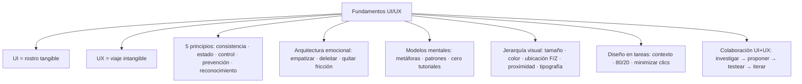

# 2 · Fundamentos del diseño UI/UX

> [!info] Asignatura
> [[DAM/Desarrollo_de_Interfaces/Indice|Desarrollo de Interfaces]] · Tema 2
> Fuente original: `Documentos/Notas/Unidad 02 - Fundamentos del diseño UI - UX.pdf` (Sergi García, sept. 2025)

## Índice del tema

- [[#1. Introducción: diseño UI/UX, dos caras de una misma moneda]]
- [[#2. Principios de diseño de interfaces gráficas]]
- [[#3. Arquitectura emocional: diseño centrado en el usuario]]
- [[#4. Modelos mentales y diseño intuitivo]]
- [[#5. Jerarquía visual e interacción]]
- [[#6. Diseño centrado en tareas y objetivos del usuario]]
- [[#7. UI vs UX: la colaboración entre ciencia y arte]]
- [[#8. Recursos recomendados para aprender UI/UX]]

---

## 1. Introducción: diseño UI/UX, dos caras de una misma moneda

UI y UX son el cerebro y el corazón de un producto: uno gestiona la funcionalidad, el otro da vida a la interacción. Disciplinas distintas pero profundamente conectadas.

| Concepto | Qué es | Ejemplo |
| --- | --- | --- |
| **UI** (User Interface) | Lo tangible: colores, tipografías, botones, iconos, layouts. El "rostro" del producto. | Un botón rojo brillante con animación al hacer clic |
| **UX** (User Experience) | Lo intangible: emociones, eficiencia, accesibilidad y satisfacción. El "viaje" completo. | Que ese botón esté donde el usuario lo espera y no lleve a un error |

> [!warning] Equilibrio
> UI hermoso + UX pobre = un deportivo sin motor (atractivo pero inútil). UX sólido + UI descuidado frustra aunque funcione.

**Regla de oro:** *"No diseñes para ti, diseña para quienes usarán tu producto"*:

- Investigar necesidades reales (entrevistas, testeos).
- Prototipar y iterar basado en feedback.
- Priorizar usabilidad sobre tendencias estéticas pasajeras.

**Ejemplo app de banca móvil:** el UI define cómo se ve el saldo (tipografía legible, color que denote seguridad); el UX asegura transferir en menos de 3 pasos sin errores.

**Impacto en el negocio:** reduce costos (menos errores = menos soporte), aumenta la retención, diferencia del producto de la competencia. El 88% de los usuarios no vuelve a un sitio tras una mala experiencia.

**Metáfora del restaurante:** UI = presentación del plato, decoración, menú visual. UX = tiempo de espera, amabilidad del camarero, sabor, cómo te sientes al pagar. Fast food = UI simple + UX eficiente; gourmet = UI sofisticado + UX memorable. Ambos exitosos: cada uno optimiza para su público.

> [!tip] Importante
> Antes de diseñar, pregúntate: ¿estoy construyendo un "fast food" digital (eficiente) o un "restaurante de experiencia" (memorable)?

## 2. Principios de diseño de interfaces gráficas

Diseñar una interfaz efectiva va más allá de hacerla "bonita": son el GPS de la usabilidad (si las señales son inconsistentes, el usuario acaba perdido y frustrado).

| Principio | Idea clave | Ejemplo real | Error común |
| --- | --- | --- | --- |
| **2.1 Consistencia** (el "déjà vu" positivo) | Mismo color para acciones similares (verde = guardar, rojo = eliminar), tipografía uniforme, iconos familiares | Google usa azul para enlaces en todos sus productos | Cambiar el sitio del "Carrito" en un e-commerce (asesino de conversiones) |
| **2.2 Visibilidad del estado del sistema** | Feedback inmediato: animaciones al clicar, spinners/barras de progreso, mensajes de éxito/error | LinkedIn muestra círculo de progreso al subir un archivo | Formulario que no indica que se está enviando (el usuario lo rellena 5 veces) |
| **2.3 Control y libertad del usuario** (la "puerta de emergencia") | Deshacer/rehacer (Ctrl+Z), salidas obvias: "Cancelar", "Volver atrás" | Gmail permite recuperar emails borrados durante 30 segundos | Compra sin opción de editar el carrito antes de pagar |
| **2.4 Prevención de errores** | Corregir cuesta 10x más que prevenir. Desactivar botones hasta completar campos, validación en tiempo real | Twitter marca en rojo al superar el límite de caracteres | Formulario que solo muestra errores después de enviar |
| **2.5 Reconocimiento > Recuerdo** | La memoria es frágil: menús explícitos, jerarquía visual (lo importante primero) | Amazon muestra categorías en un menú desplegable gigante | App de banca que esconde transferencias en un menú hamburguesa |

## 3. Arquitectura emocional: diseño centrado en el usuario

No basta con que funcione: la interfaz debe hacer que los usuarios se sientan capaces, satisfechos y hasta felices. Diseñar no solo para los ojos, sino para el corazón. El 95% de las decisiones de compra son subconscientes (guiadas por emociones). Ejemplos: Apple vende experiencias de lujo y simplicidad; Duolingo convierte aprender idiomas en un juego.

**Claves para diseñar emociones:**

1. **Empatizar** — más allá de los datos:
   - Mapas de empatía: ¿qué siente, piensa, oye y ve tu usuario?
   - Personas *con emociones*: no solo "Juan, 30 años", sino "Juan siente ansiedad al pagar online y necesita seguridad".
   - Ejemplo: Spotify con playlists "Canciones para días lluviosos".
2. **Experiencias memorables** (no solo usables):
   - Microinteracciones: animaciones que dan feedback (corazón que "late" al dar like).
   - Sorpresa y deleite: el "gracias" animado de Slack al cerrar sesión; los Doodles de Google.
3. **Eliminar fricciones** (enemigas de las emociones positivas):
   - Fricción = cualquier obstáculo que genere frustración (formularios largos, pasos redundantes).
   - Simplificar flujos y usar lenguaje humano ("Ups, esta página se fue de paseo" en vez de "Error 404").
   - Ejemplo: Amazon "1-Click Order" (elimina el carrito para usuarios frecuentes).

**Ejemplo profundo — el botón que "cobra vida"** (botón "Donar" en una ONG):

- Sin emociones: gris, estático → el usuario duda.
- Con arquitectura emocional: color cálido (naranja = urgencia + positividad), animación sutil de "respirar" al pasar el ratón, feedback al clicar ("¡Gracias por salvar vidas!" + sonido de campana) → impacto inmediato y satisfacción.

**Técnicas avanzadas:** psicología del color (azul = confianza, bancos; rojo = urgencia, botón "Reproducir" de Netflix) · storytelling en UI (Airbnb cuenta historias de viajes, no muestra propiedades) · sonidos emocionales (el "pling" de WhatsApp).

## 4. Modelos mentales y diseño intuitivo

**Modelo mental:** representación interna que una persona tiene sobre cómo funciona un sistema, basada en experiencias previas. El cerebro procesa imágenes 60.000 veces más rápido que el texto. Ejemplo clásico: disquete = guardar (el icono persiste aunque los disquetes ya no existan).

**A. Metáforas visuales universales:** papelera → eliminar · carpeta → agrupar contenidos · lupa → buscar. Caso: la calculadora skeumórfica de Apple (texturas 3D que imitan objetos reales). Error: iconos abstractos sin referencia cultural (un triángulo verde para "guardar").

**B. Patrones de interacción aprendidos:** menú hamburguesa (≡) = navegación · swipe izquierda = eliminar (gracias a Mail de Apple) · arrastrar y soltar. Tinder popularizó swipe right = like (hoy lo usa LinkedIn). ¿Cuándo romper el patrón? Solo si aportas un valor claro (Pinterest con el scroll infinito).

**C. Diseño que no necesita instrucciones:** *si necesitas un tutorial, tu diseño ha fallado.*

- Jerarquía visual obvia (el "Reproducir" verde y gigante de Spotify).
- Affordances claras (un botón 3D que parece clickeable).
- Agrupación lógica (direcciones en un mismo bloque del formulario).
- Ejemplo brillante: Google Search — un solo campo centrado con la lupa al lado.

> [!failure] Casos de fracaso por ignorar modelos mentales
> - **Word 2007 (Ribbon):** sustituyó los menús por pestañas y los usuarios tardaron años en adaptarse.
> - **Instagram 2020:** movió el botón central de "crear publicación" para poner "Reels", rompiendo el flujo mental habitual de los usuarios.

## 5. Jerarquía visual e interacción

La jerarquía visual es el GPS de la interfaz: dice dónde mirar primero, segundo y tercero. El cerebro decide en 50 ms si una interfaz es fiable, y el 94% abandona un sitio si la información es difícil de escanear (NNGroup).

**Técnicas:**

1. **Tamaño = importancia** — lo más grande se ve primero. Título h1 2-3x más grande que el texto; CTA principal más grande que los secundarios (Spotify: "Reproducir" enorme y verde, "Guardar" discreto).
2. **Color y contraste** — los cálidos (rojo, naranja) atraen más que los fríos; alto contraste texto/fondo; un solo color acentuado para lo clave (Amazon: "Añadir al carrito" en amarillo sobre fondo blanco).
3. **Ubicación estratégica** — patrones de lectura: **F-Shaped** (web: escaneo horizontal y luego vertical) y **Z-Shaped** (landing pages con pocos elementos). Zonas clave: esquina superior izquierda = logo y menú; centro superior = título; final de la "F" = llamadas a la acción. Netflix pone "Reproducir" en el centro.
4. **Espaciado y agrupación (ley de proximidad)** — elementos relacionados juntos, no relacionados separados (formulaires por bloques; Airbnb agrupa precio, valoración y ubicación junto a la foto).
5. **Tipografía y peso visual** — 1. título (bold, grande) → 2. subtítulo (semibold, menor) → 3. cuerpo (normal, legible). NYT: título Georgia 32px bold, subtítulo Georgia 22px, cuerpo Helvetica 16px.

**Análisis de una landing (objetivo: suscripción a newsletter):** título grande en negrita → subtítulo menor → campo de email destacado → CTA "Suscribirse" en verde contrastante → texto legal pequeño y gris para no distraer.

> [!failure] Errores que rompen la jerarquía
> Todo compite por atención (todo en negrita/brillante) · falta de contraste (gris claro sobre blanco) · espaciado inconsistente · más de 2-3 tipografías.

## 6. Diseño centrado en tareas y objetivos del usuario

No se trata de lo que tú quieres mostrar, sino de lo que el usuario necesita hacer. El 55% abandona una app si no encuentra lo que busca en menos de 15 segundos (Google). Uber no muestra "la historia de la empresa": muestra un botón gigante para pedir un viaje.

**Los tres pilares:**

1. **Conocer los contextos de uso** — app de reparto: usuarios con prisa en la calle; banca online: en casa, con calma. Herramientas: entrevistas, mapas de calor. WhatsApp pone la cámara accesible desde el chat porque los usuarios envían fotos rápidas.
2. **Priorizar lo relevante (regla 80/20)** — el 20% de las funciones genera el 80% del uso: hacerlas obvias y eliminar ruido visual (en Spotify "Buscar" y "Reproducir" siempre visibles, "Ajustes" escondido; Google Search es solo un campo de texto). Error: saturar "por si acaso" (menús de TV de pago con 500 canales).
3. **Minimizar pasos** — cada paso extra en un formulario reduce la conversión un 10% (Baymard Institute). Autocompletado, progreso visible ("Paso 1 de 3"), acciones de un clic ("Comprar ahora"). Duolingo deja empezar una lección sin registro.

**Ejemplo práctico — app de reparto de comida** (objetivo: saber dónde está el pedido y cuándo llegará): pantalla principal = mapa grande con el repartidor (80%), tiempo estimado en negrita, botón flotante "Contactar al repartidor"; escondido = ajustes, historial y promociones. Si la app muestra primero "Ofertas" o "Perfil", los usuarios se frustran.

> [!failure] Errores que matan la eficiencia
> Esconder la función principal ("Pedir comida" en un menú hamburguesa) · sobrecargar con información irrelevante · flujos redundantes (confirmación en cada paso).

## 7. UI vs UX: la colaboración entre ciencia y arte

Son disciplinas complementarias pero distintas: un arquitecto (UX) asegura que la casa no se caiga; un diseñador de interiores (UI), que sea hermosa y acogedora.

| Aspecto | UX (User Experience) | UI (User Interface) |
| --- | --- | --- |
| Enfoque | ¿Funciona bien? (lógica, flujos, usabilidad) | ¿Se ve bien? (estética, interactividad visual) |
| Objetivo | Solucionar problemas del usuario | Comunicar la marca de forma atractiva |
| Proceso | Investigación, wireframes, testeos | Diseño visual, animaciones, prototipos |
| Herramientas | Miro, FigJam, Hotjar, UserTesting | Figma, Adobe XD, Sketch, After Effects |
| Métrica | Tasa de éxito en tareas, satisfacción | Atractivo visual, consistencia de marca |

**Colaboración — UX define el "qué" y el "por qué"** (investigar necesidades, wireframes y user flows, testear con usuarios): el equipo UX de Spotify descubre que los usuarios quieren saltar intros de podcasts. **UI diseña el "cómo"** (transformar wireframes en interfaces coherentes, aplicar guías de estilo, prototipar animaciones): el equipo UI diseña el botón de "saltar 15 segundos" con icono intuitivo y sonido satisfactorio.

> [!failure] Errores comunes en la colaboración
> Trabajar en silos (bonito pero inusable) · saltarse la investigación (diseñar pantallas antes de validar flujos) · priorizar estética sobre funcionalidad (botones "minimalistas" que nadie ve). Caso real: **Snapchat 2018** rediseñó sin considerar hábitos → 1,2M de quejas y caída del 25% en ingresos.

**Flujo ideal de trabajo conjunto:** 1. UX investiga → 2. UI propone opciones visuales → 3. juntos testean con usuarios → 4. iteran. Ejemplo de éxito: Airbnb — UX detectó que los usuarios necesitaban "confianza" para reservar; UI respondió con fotos grandes de anfitriones y reseñas prominentes.

## 8. Recursos recomendados para aprender UI/UX

- **Libros:** *No me hagas pensar* (Steve Krug) · *The Design of Everyday Things* (Don Norman) · *Articulating Design Decisions* (Tom Greever).
- **Cursos:** Google UX Design Professional Certificate (Coursera) · UI/UX Design Specialization (CalArts) · Introduction to UX Design (Georgia Tech).
- **Herramientas:** Figma (líder colaborativo) · Adobe XD · Maze (testeo de prototipos).
- **Blogs/comunidades:** NNGroup · Smashing Magazine · UX Collective (Medium).
- **YouTube:** AJ&Smart (design sprints) · Flux (UI/UX y freelancing) · Figma oficial.
- **Podcasts:** Design Matters · UX Coffee Break.
- **Inspiración:** Dribbble · Awwwards · Behance.
- **Accesibilidad:** WAVE · Stark (plugin de contraste).

---

## Esquema

## Para repasar

- [ ] Explicar la diferencia UI/UX con el ejemplo del restaurante y saber cuándo "el equilibrio es clave".
- [ ] Nombrar los 5 principios de diseño con un ejemplo real y un error común de cada uno.
- [ ] Definir modelo mental y justificar el icono del disquete.
- [ ] Diferenciar patrón F-Z de lectura y colocar zonas clave (logo, título, CTA).
- [ ] Recitar las cifras: 88% no vuelve · 95% decisiones subconscientes · 10x prevenir vs corregir · 10% conversión por paso · 55% abandona en 15s.
- [ ] Reconstruir el flujo de trabajo conjunto UX→UI con el caso Airbnb.
- [ ] Caso de fracaso: Snapchat 2018 y el Ribbon de Word: ¿qué principio violan?
