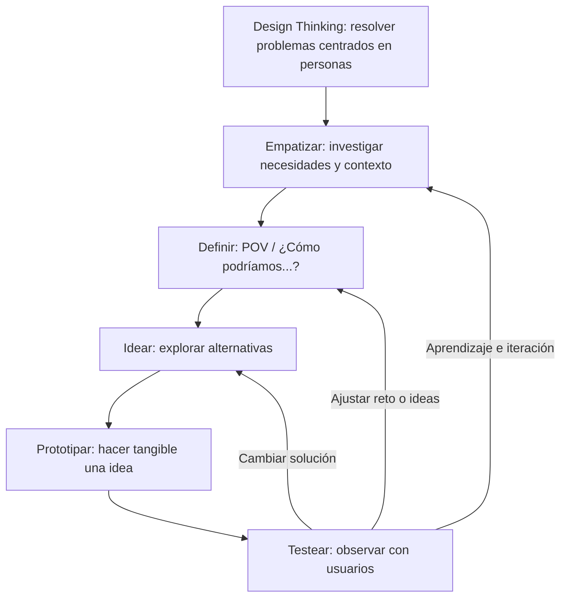

# 3 · Introducción al Design Thinking

> [!info] Asignatura
> [[DAM/Desarrollo_de_Interfaces/Indice|Desarrollo de Interfaces]] · Tema 3  
> Fuentes: `Unidad 03 - Introducción al Design Thinking.pdf`, `Unidad 03 - Cheat Sheet_ Design Thinking.pdf` y `Unidad 03 - Checklist – ¿Estoy aplicando Design Thinking_.pdf` (Sergi García, septiembre de 2025).

## Índice del tema

- [[#1. Qué es el Design Thinking]]
- [[#2. Principios y características]]
- [[#3. Las cinco fases del proceso]]
- [[#4. Aplicación al diseño de interfaces]]
- [[#5. Ejemplo práctico: una app para la biblioteca]]
- [[#6. Ejemplo integrador: FocusFlow]]
- [[#7. Cuándo conviene utilizarlo]]
- [[#8. Checklist de aplicación]]
- [[#9. Recursos recomendados]]

---

## 1. Qué es el Design Thinking

El **Design Thinking** (pensamiento de diseño) es un enfoque para resolver problemas complejos e impulsar soluciones innovadoras, poniendo en el centro las **necesidades reales de las personas**. Combina métodos de diseño, psicología y negocio; su popularización se asocia a IDEO y a la Universidad de Stanford.

En lugar de empezar por la tecnología disponible o por lo que el equipo supone que necesita el usuario, se investiga a las personas, se reformula el problema y se prueban posibles soluciones. Es especialmente útil cuando el problema todavía es ambiguo o no está bien definido.

> [!tip] Idea esencial
> No diseñamos para nosotros mismos: diseñamos para quienes usarán el producto. La evidencia obtenida al observar y probar debe pesar más que las preferencias personales del equipo.

### Design Thinking y diseño tradicional

| Aspecto | Design Thinking | Enfoque tradicional |
| --- | --- | --- |
| Punto de partida | Necesidades y contexto de las personas | Requisitos técnicos o de negocio ya establecidos |
| Proceso | Iterativo y flexible | Habitualmente secuencial |
| Participación del usuario | Continua, desde las primeras fases | Puntual o al final |
| Prototipado | Temprano, sencillo y modificable | Más tardío, cuando la solución está más cerrada |
| Pruebas | Se realizan pronto para aprender y corregir | Pueden llegar cuando cambiar resulta más costoso |

No son enfoques incompatibles: la elección depende del tipo de problema, la estabilidad de los requisitos y el nivel de incertidumbre.

## 2. Principios y características

1. **Centrado en las personas:** comprender necesidades, motivaciones, frustraciones y contexto mediante investigación, no mediante suposiciones.
2. **Empático:** escuchar y observar también aquello que el usuario no expresa directamente. Hay que dejar en suspenso los prejuicios del equipo.
3. **Iterativo y no lineal:** las fases no forman una escalera de sentido único. Una prueba puede llevar a idear otra solución, redefinir el reto o investigar de nuevo.
4. **Colaborativo:** reúne perspectivas diferentes —diseño, desarrollo, negocio y usuarios— para evitar que una sola visión limite el resultado.
5. **Visual y tangible:** mapas, esquemas, bocetos y prototipos hacen las ideas visibles y facilitan hablar de ellas sin depender de explicaciones técnicas.
6. **Orientado a la acción:** se aprende haciendo. Conviene probar pronto, en vez de prolongar debates teóricos sin evidencia.

> [!warning] Ningún prototipo es sagrado
> Si los datos de las pruebas muestran que la solución no funciona, se modifica. El prototipo sirve para aprender, no para defender una idea a toda costa.

### Herramientas para colaborar e investigar

- **Mapa de empatía:** organiza lo que el usuario dice, hace, piensa y siente; ayuda a detectar necesidades y contradicciones.
- **Entrevista abierta o etnográfica:** pregunta por experiencias concretas. Por ejemplo: «Cuéntame la última vez que te frustraste usando esta aplicación».
- **User Persona:** perfil sintético basado en datos de usuarios reales; representa objetivos, contexto y dificultades, no una persona inventada a partir de estereotipos.
- **Customer/User Journey Map:** representa los pasos de una experiencia, junto con pensamientos, emociones y dificultades en cada punto.
- **Brainwriting:** cada persona escribe ideas individualmente antes de ponerlas en común; reduce el efecto de que una voz domine la sesión.
- **Timeboxing:** limita el tiempo de una actividad para favorecer la acción y evitar la parálisis por análisis.

## 3. Las cinco fases del proceso

Las cinco fases más habituales son **Empatizar → Definir → Idear → Prototipar → Testear**. Son una guía para organizar el trabajo, no una secuencia rígida.

### 3.1 Empatizar

**Objetivo:** conocer a las personas usuarias, sus necesidades y el contexto real en que realizan una tarea.

**Técnicas:**

- Entrevistas en profundidad con preguntas abiertas y neutrales.
- Observación contextual: ver cómo se completa una tarea en su entorno habitual.
- Mapa de empatía, User Persona y Customer Journey Map.
- En el diseño de interfaces, **card sorting**: pedir a los usuarios que agrupen conceptos o funciones para ayudar a organizar la navegación y la arquitectura de información.

**Evita preguntas dirigidas.** En vez de «¿Te gustaría que añadiéramos una función de recordatorios?», pregunta «¿Cómo recuerdas actualmente las fechas de entrega?».

**Resultado esperado:** evidencias, necesidades e *insights* (hallazgos que explican por qué ocurre un comportamiento). Ejemplo: observar que las personas tiran verduras puede revelar que olvidan su fecha de caducidad; la necesidad no es necesariamente «más recetas», sino recordar qué alimentos deben consumir.

### 3.2 Definir el problema

**Objetivo:** sintetizar lo aprendido y formular el problema desde la perspectiva del usuario. Se distingue el **síntoma** de la causa subyacente.

Dos formatos útiles:

- **POV (Point of View):** «[Usuario] necesita [necesidad] porque [insight]».
- **HMW (How Might We? / ¿Cómo podríamos…?):** convierte el reto en una pregunta abierta que invita a proponer alternativas: «¿Cómo podríamos ayudar a estudiantes a recordar los plazos para que entreguen sus tareas a tiempo?».

| Formulación superficial (síntoma) | Reformulación orientada a la causa |
| --- | --- |
| Los usuarios no completan el registro | El formulario solicita demasiados datos personales antes de mostrar el valor del servicio |
| Los estudiantes no usan la plataforma | Les cuesta encontrar las tareas y no recuerdan las fechas de entrega |

> [!warning] Evita cerrar la solución demasiado pronto
> «¿Cómo podríamos crear una notificación?» ya presupone una solución. Es mejor describir primero la necesidad o el resultado que se busca.

### 3.3 Idear

**Objetivo:** generar opciones variadas antes de seleccionar una. Primero se amplía el abanico; después se evalúa y prioriza.

**Técnicas:**

- **Brainstorming:** priorizar cantidad, aplazar el juicio, construir sobre ideas ajenas y aceptar propuestas inesperadas.
- **Crazy 8s:** dibujar ocho ideas en ocho minutos para explorar alternativas con rapidez.
- **SCAMPER:** transformar una propuesta preguntando si se puede **Sustituir, Combinar, Adaptar, Modificar, Proponer otros usos, Eliminar** o **Reordenar**.
- **Mapas mentales:** ramificar posibles respuestas a partir del reto central.

La cantidad ayuda a superar las primeras soluciones obvias. Una idea aparentemente disparatada puede inspirar una alternativa viable; no significa que toda idea deba implementarse.

### 3.4 Prototipar

**Objetivo:** convertir una o varias ideas en representaciones que se puedan enseñar y probar. Un prototipo debe ser suficientemente útil para responder una pregunta, no perfecto.

| Fidelidad | Ejemplos | Útil para validar |
| --- | --- | --- |
| Baja | Bocetos en papel, post-its, storyboard | Concepto, disposición general y flujo |
| Media | Wireframe o maqueta digital estática en Figma o Balsamiq | Estructura, jerarquía y comprensión visual |
| Alta | Prototipo digital interactivo | Interacciones, navegación y detalles del flujo |

También existe el **Wizard of Oz**: el usuario cree que interactúa con un sistema automatizado, pero una persona ejecuta manualmente parte de la respuesta (por ejemplo, un chatbot atendido detrás de escena). Así se puede validar la experiencia antes de construir la automatización.

**Regla práctica:** fallar pronto y a bajo coste. Un boceto en papel puede revelar un problema de navegación antes de programar.

### 3.5 Testear

**Objetivo:** comprobar con usuarios reales si la propuesta resuelve el problema y localizar obstáculos.

**Métodos:**

- **Think Aloud (pensar en voz alta):** la persona verbaliza qué intenta hacer y qué entiende mientras realiza una tarea.
- **Test de los cinco segundos:** se enseña una pantalla brevemente y se pregunta qué propósito o información recuerda.
- **Test A/B:** se comparan dos alternativas para una pregunta concreta, como la comprensión o el rendimiento de dos diseños.
- **Prueba remota o no moderada:** se observa el uso en remoto, a veces mediante grabación de pantalla y comentarios.
- **Escalas de valoración:** después de una tarea se pregunta, por ejemplo, qué facilidad tuvo del 1 al 5.
- **Heatmaps:** visualizaciones que ayudan a localizar clics o zonas de interacción; complementan la observación, pero no explican por sí solas por qué actuó así el usuario.

> [!tip] Observa lo que hacen, no solo lo que dicen
> Si alguien afirma que una pantalla es clara, pero no encuentra el botón principal, el comportamiento observado señala un problema que conviene investigar.

Después de testear se decide qué mantener, cambiar o volver a investigar. Si una prueba descubre un sesgo en las personas entrevistadas, se regresa a empatizar; si el flujo no se entiende, puede ser necesario idear o prototipar otra opción.

## 4. Aplicación al diseño de interfaces

Design Thinking ayuda a transformar necesidades en interfaces comprensibles antes de invertir en su desarrollo:

1. **Comprender los objetivos:** entrevistas, observación y mapas de recorrido revelan dónde se atasca el usuario y qué espera encontrar.
2. **Definir el reto y el flujo:** redactar un POV/HMW y dibujar cómo se pasa de una pantalla a otra. La arquitectura de información organiza contenidos y funciones con nombres reconocibles.
3. **Explorar alternativas:** proponer distintos patrones, jerarquías y recorridos, sin decidirse por la primera idea.
4. **Probar opciones visuales:** usar sketches, wireframes o prototipos interactivos según la pregunta que se quiera responder.
5. **Corregir antes de codificar:** detectar botones poco visibles, falta de contraste, etiquetas confusas o pasos redundantes cuando todavía es barato cambiar el diseño.

| Pregunta de diseño | Prototipo o prueba apropiada |
| --- | --- |
| ¿Se entiende qué ofrece la pantalla? | Boceto o test de cinco segundos |
| ¿Se encuentra una función en la navegación? | Wireframe y prueba de tareas |
| ¿Se comprende el flujo completo? | Prototipo interactivo y Think Aloud |
| ¿Qué variante resulta más eficaz para un objetivo concreto? | Test A/B bien definido |

El tipo de prototipo depende de lo que se necesite aprender: no hace falta simular todo el producto para validar una parte del recorrido.

## 5. Ejemplo práctico: una app para la biblioteca

**Situación inicial:** los estudiantes hacen cola para preguntar si un libro está disponible.

1. **Empatizar:** se entrevista a estudiantes y se observa cómo consultan el catálogo. Aparece una necesidad: conocer la disponibilidad actual sin desplazarse ni preguntar.
2. **Definir:** «¿Cómo podríamos ayudar a estudiantes a comprobar la disponibilidad y reservar un libro desde el móvil?».
3. **Idear:** búsqueda destacada, filtros por género, código QR en los libros, reserva y aviso cuando un ejemplar vuelva a estar disponible.
4. **Prototipar:** wireframe con barra de búsqueda, estado «Disponible/Reservado», plazo de devolución y botón «Reservar».
5. **Testear:** se pide a estudiantes que encuentren y reserven un libro. Si no ven la fecha de devolución o piden filtros, se actualiza el prototipo y se vuelve a probar.

La solución concreta no debe darse por válida hasta observar si ayuda a completar la tarea. El proceso puede cambiar la formulación del reto o descartar funciones que no resuelven una necesidad prioritaria.

## 6. Ejemplo integrador: FocusFlow

El material propone **FocusFlow**, una plataforma para ayudar a estudiantes y profesionales a mantener hábitos de estudio y reducir la procrastinación.

- **Empatizar:** diarios de estudio, entrevistas y mapas de empatía muestran aislamiento, dificultad para empezar tareas grandes, distracciones y falta de reconocimiento de los avances.
- **Definir:** los usuarios necesitan apoyo para dividir el estudio en objetivos asumibles y sentirse acompañados, sin aumentar la presión ni las distracciones.
- **Idear:** sesiones de estudio compartidas, tareas divididas en metas pequeñas, progreso visual, recompensas y grupos privados de apoyo.
- **Prototipar:** diseñar el recorrido esencial: establecer un objetivo, iniciar una sesión, ver el progreso y revisar el resultado.
- **Testear:** comprobar si se entiende el sistema de recompensas y si las salas compartidas resultan cómodas. El feedback puede llevar a explicar mejor las recompensas, ofrecer grupos privados o mostrar el progreso a largo plazo.

El ejemplo ilustra que una investigación puede modificar la propuesta: el objetivo no es añadir funciones llamativas, sino resolver las dificultades que los usuarios han expresado y que se han observado.

## 7. Cuándo conviene utilizarlo

| Design Thinking suele encajar cuando… | Un enfoque más tradicional puede encajar cuando… |
| --- | --- |
| El problema es ambiguo o se conoce poco a los usuarios | Los requisitos están claros, son estables y verificables |
| Se busca innovación o mejorar una experiencia | Se debe ejecutar una solución ya definida |
| Hace falta contrastar varias alternativas | El alcance y la solución están suficientemente especificados |
| Un equipo multidisciplinar puede colaborar | El trabajo es principalmente técnico y especializado |

En sistemas sujetos a regulación o con requisitos estrictos puede seguir siendo valioso investigar y probar la experiencia, aunque haya menos libertad para cambiar ciertas reglas. La metodología se adapta al contexto.

**Ventajas principales:**

- Identifica necesidades que no aparecen en una lista de requisitos inicial.
- Hace visibles problemas de comprensión y usabilidad antes de construir el producto.
- Reduce el riesgo de desarrollar una solución que nadie necesita.
- Facilita la colaboración al trabajar con representaciones concretas.
- Promueve aprendizaje e innovación mediante ciclos cortos de prueba y mejora.

> [!info] Frase para recordar
> «El Design Thinking diseña lo correcto; los métodos tradicionales ayudan a diseñarlo correctamente».

## 8. Checklist de aplicación

Marca cada pregunta con **sí** o **no**. No es una certificación, sino una herramienta para detectar qué falta por aprender.

### ¿Tiene sentido aplicar Design Thinking?

- [ ] ¿El problema que intento resolver no está claramente definido?
- [ ] ¿Conozco poco a mi público o sus necesidades son variadas?
- [ ] ¿Busco algo más que cumplir una función técnica?
- [ ] ¿La solución debe adaptarse a la experiencia de las personas usuarias?
- [ ] ¿Estoy dispuesto a cambiar mi idea según lo que descubra?

La checklist original recomienda considerar el enfoque si se responden afirmativamente tres o más preguntas.

### Revisión de las fases

- [ ] **Empatizar:** ¿he hablado con usuarios reales o potenciales? ¿He entendido hábitos, emociones y dificultades?
- [ ] **Definir:** ¿he reformulado el reto desde su perspectiva? ¿Tengo un POV o una pregunta «¿Cómo podríamos…?» abierta?
- [ ] **Idear:** ¿he producido varias alternativas antes de escoger? ¿He aplazado el juicio durante la generación de ideas?
- [ ] **Prototipar:** ¿he creado una representación sencilla que se pueda modificar?
- [ ] **Testear:** ¿he observado a personas reales usando el prototipo? ¿He cambiado algo a partir de sus acciones o comentarios?

> [!tip] No es obligatorio seguir las fases en orden
> Lo importante es que cada ciclo permita aprender, corregir y mejorar a partir de las personas usuarias.

## 9. Recursos recomendados

- **Libros:** *Change by Design* (Tim Brown) · *The Design Thinking Playbook* (Michael Lewrick, Patrick Link y Larry Leifer) · *Design Thinking for Strategic Innovation* (Idris Mootee).
- **IDEO U:** [Introduction to Design Thinking](https://www.ideou.com/products/introduction-to-design-thinking).
- **Stanford d.school:** [recursos y herramientas](https://dschool.stanford.edu/resources).
- **Plantillas de Miro:** [Design Thinking](https://miro.com/templates/design-thinking/).
- **Figma:** [recursos de Design Thinking](https://www.figma.com/design-thinking/).

---

## Esquema

## Para repasar

- [ ] Definir Design Thinking y explicar por qué es iterativo y centrado en las personas.
- [ ] Comparar el enfoque con un proceso tradicional: punto de partida, participación del usuario, prototipos y pruebas.
- [ ] Enumerar y explicar las cinco fases: empatizar, definir, idear, prototipar y testear.
- [ ] Diferenciar síntoma y causa; formular un POV y una pregunta HMW que no presuponga la solución.
- [ ] Explicar las reglas básicas del brainstorming y describir Crazy 8s y SCAMPER.
- [ ] Distinguir prototipos de baja, media y alta fidelidad y explicar el método Wizard of Oz.
- [ ] Elegir una prueba apropiada para evaluar comprensión, navegación o interacción.
- [ ] Justificar por qué en un test se observa lo que hacen los usuarios y no solo lo que dicen.
- [ ] Aplicar las fases al ejemplo de la biblioteca y proponer cómo iterar según el feedback.
- [ ] Usar la checklist para reconocer cuándo tiene sentido aplicar Design Thinking.
