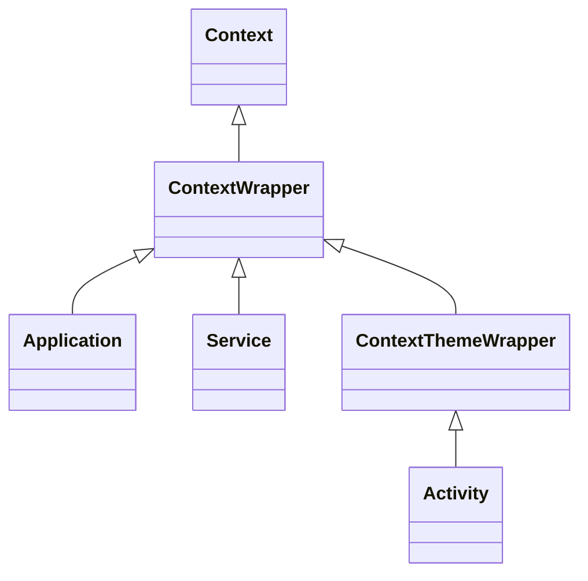
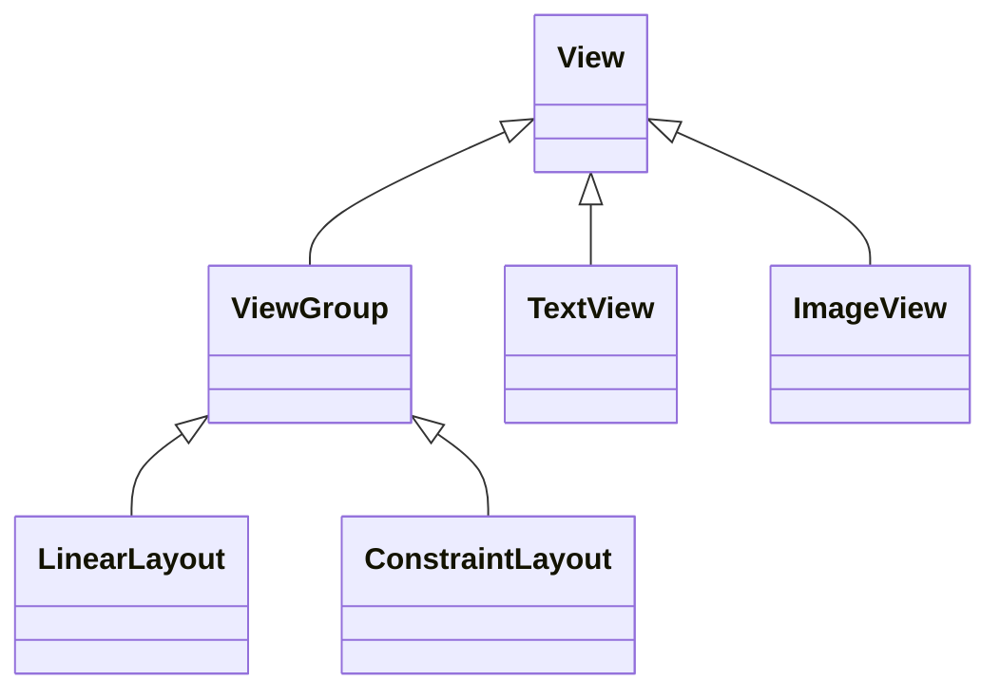
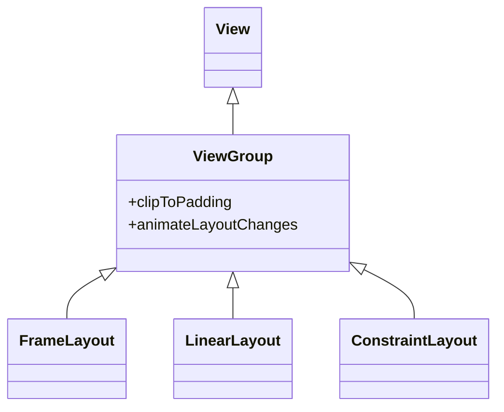

# 2 · Creación de un proyecto

> [!info] Asignatura
> **Optativa** · [[DAM/Programacion_Multimedia_y_Dispositivos_Moviles/Indice|temario en Programación Multimedia y Dispositivos Móviles]] · Tema 2 · Android (vistas)
> Tema anterior: [[01 - Introducción a la programación para Android]] · Tema siguiente: [[03 - Recursos]]

> [!info] Material de referencia
> [Creación de un proyecto](https://educacionadistancia.juntadeandalucia.es/centros/cadiz/pluginfile.php/244507/mod_resource/content/1/a02%20-%20Creacion%20de%20un%20proyecto/)

## Índice del tema

- [[#1. Asistente de proyecto]]
- [[#2. Estructura de un proyecto]]
- [[#3. Componentes en una aplicación Android]]
- [[#4. Contexto]]
- [[#5. Activity]]
- [[#6. Especificación XML de layout]]
- [[#7. View]]
- [[#8. Propiedades, métodos y atributos XML principales de View]]
- [[#9. Namespaces XML en Android]]
- [[#10. Propiedades principales de ViewGroup]]
- [[#11. Recursos y la clase R]]
- [[#12. Recursos de id]]
- [[#13. Referencia a vistas desde código Kotlin]]
- [[#14. ViewBinding]]
- [[#15. Ejecución del proyecto]]

---

## 1. Asistente de proyecto

Para estudiar la creación de nuestra primera aplicación Android, vamos a desarrollar un proyecto muy básico que simplemente mostrará el mensaje "Hello world!" cuando la ejecutemos.

Si estamos en la pantalla de bienvenida de Android Studio, pulsaremos el botón `New Project`. También podemos usar el menú `File -> New -> New Project`. Como resultado se mostrará el asistente de creación de proyectos proporcionado por Android Studio.

En el asistente, el primer paso será seleccionar la plantilla _Empty Views Activity_ dentro de la pestaña _Phone and Tablet_, para indicar que queremos generar una actividad vacía, tal y como se muestra en la figura

> [!note]- 🖼️ Imagen: Selección de la plantilla Empty Views Activity
> En los apuntes del aula hay aquí una imagen; solo se ve con la sesión iniciada: [abrir imagen](https://educacionadistancia.juntadeandalucia.es/centros/cadiz/pluginfile.php/244507/mod_resource/content/1/files/emptyactivitytemplate.png)

Como consecuencia se nos mostrará la pantalla de configuración del proyecto:

> [!note]- 🖼️ Imagen: Configuración del proyecto en el asistente
> En los apuntes del aula hay aquí una imagen; solo se ve con la sesión iniciada: [abrir imagen](https://educacionadistancia.juntadeandalucia.es/centros/cadiz/pluginfile.php/244507/mod_resource/content/1/files/configureprojecttemplate.png)

En la pantalla de configuración del proyecto indicaremos:

- El nombre de la aplicación: Corresponde al nombre que se mostrará para la aplicación en el cajón de aplicaciones del dispositivo cuando ésta se instale. Podremos cambiarla posteriormente. Por ejemplo `HelloWorld`
- El nombre del paquete de la aplicación: Debe ser único entre todas la aplicaciones instaladas en el dispositivo. Por este motivo se suele usar como nombre de paquete la URL inversa de la compañía que desarrolla la aplicación más el nombre de la misma. Por ejemplo: `es.iessaladillo.pedrojoya.helloworld`
- La carpeta en la que va a generarse el proyecto: Debemos indicar una carpeta vacía (aunque no exista aún) en la que se deben crear todo el árbol de archivos y carpetas del proyecto.
- El lenguaje de programación a usar, Java o Kotlin (opción recomendada).
- El nivel mínimo de API con el que debe funcionar la aplicación: Determina qué dispositivos podrán instalar nuestra aplicación. Por ejemplo `API 27 ("Oreo"; Android 8.1)`. A través del enlace `Help me choose` podemos acceder a una estadística de distribución de uso para ayudarnos a decidir la versión adecuada.
- El lenguaje a usar en los archivos configuración de Gradle: Gradle permite usar tanto el lenguaje Groovy como el lenguaje Kotlin, que es la opción recomendada.

Al pulsar el botón `Finish` Android Studio generará el proyecto para nosotros con una serie de elementos que vamos a ir conociendo a continuación.

## 2. Estructura de un proyecto

Cuando creamos un nuevo proyecto en Android Studio se genera automáticamente la estructura básica de archivos y carpetas necesaria para la aplicación, como vemos en la imagen.

Dicha imagen corresponde a la vista de Android Studio conocida como `Project`. Normalmente la vista habitual es `Android` que nos simplifica la visión para acceder más rápidamente a los elementos.

> [!note]- 🖼️ Imagen: Estructura de un proyecto
> En los apuntes del aula hay aquí una imagen; solo se ve con la sesión iniciada: [abrir imagen](https://educacionadistancia.juntadeandalucia.es/centros/cadiz/pluginfile.php/244507/mod_resource/content/1/files/projecttree.png)

Un proyecto Android estará compuesto de uno o más **módulos**.

> [!definition] Módulo
> Un módulo es un elemento de nuestro proyecto que puede representar una aplicación distinta, una versión diferente de una misma aplicación, o un componente adicional del sistema (aplicación servidor, librería, …).

Nuestro proyecto contendrá fuera de cualquier módulo dos ficheros de configuración de la generación de la aplicación, llamados `/settings.gradle` y `/build.gradle`, que serán usados por el generador Gradle a la hora de generar el ejecutable de nuestra aplicación.

Veamos primero el archivo `settings.gradle`, en el que se configuran entre otras cosas los respositiorios de los que se deben obtener los plugins que se aplican, las dependencias a las librerías que se establecen, el nombre de la aplicación y los módulos que la conforman.

**`settings.gradle.kts`**

```kotlin
pluginManagement {
    // Repositorios para los plugins
    repositories {
        google {
            content {
                includeGroupByRegex("com\\.android.*")
                includeGroupByRegex("com\\.google.*")
                includeGroupByRegex("androidx.*")
            }
        }
        mavenCentral()
        gradlePluginPortal()
    }
}
dependencyResolutionManagement {
    repositoriesMode.set(RepositoriesMode.FAIL_ON_PROJECT_REPOS)
    // Repositorios para las dependencias
    repositories {
        google()
        mavenCentral()
    }
}
// Nombre del proyecto
rootProject.name = "HelloWorld"
// Módulos del proyecto
include(":app")
```

Por su parte, en archivo `build.gradle.kts` contiene por ejemplo información sobre los plugins a aplicar en la construcción:

**`build.gradle.kts`**

```kotlin
// Plugins a aplicar durante la construcción
plugins {
    alias(libs.plugins.android.application) apply false
    alias(libs.plugins.kotlin.android) apply false
}
```

Al crear un proyecto el asistente de Android Studio crea automáticamente un módulo correspondiente a nuestra aplicación principal, que toma el nombre de `app`, como vemos en la imagen anterior, y se crea una carpeta para él, llamada `app`.

Dentro del módulo `app` se crea una subcarpeta llamada `src`, que contendrá el código fuente del módulo correspondiente.

Dentro de la carpeta `src` se crean tres subcarpetas que organizan el distinto código fuente:

- `main`: Contendrá el código fuente de desarrollo del módulo. Por ahora nos centraremos en esta carpeta.
- `test`: Contendrá el código fuente correspondiente a los tests unitarios de las distintas clases (por ejemplo, JUnit).
- `androidTest`: Contendrá el código fuente correspondiente a los tests instrumentales que se ejecutan sobre un dispositivo.

Dentro de la carpeta `app/src/main` se crean una serie de subcarpetas muy importantes:

- `app/src/main/java`: Contiene el código fuente de la aplicación, incluyendo el código de las actividades (pantallas de la aplicación) y demás componentes, clases auxiliares, modelos de datos, etc. El asistente de creación de proyecto de Android Studio creará de manera automática el código básico de la actividad principal de la aplicación dentro del paquete java que hayamos especificado en el asistente, nombrándola `MainActivity`.
- `app/src/main/res/`: Contiene todos los archivos de recursos que va a utilizar el proyecto. Un archivo de recurso puede ser una imagen, un vídeo, un fichero con constantes de cadenas de texto, una especificación XML para un menú, etc.

Los diferentes archivos de recursos de organizan en subcarpetas de la carpeta `res`, atendiendo al tipo de recurso del que se trate. Entre las subcarpetas posibles destacamos las siguientes:

- `drawable`: Contiene las imágenes y archivos de gráficos de la aplicación.
- `layout`: Contiene los ficheros de definición del diseño (_layout_) de las diferentes pantallas de la interfaz gráfica.
- `mipmap`: Contiene el archivo gráfico correspondiente al icono de la aplicación.
- `values`: Contiene los archivos de recursos en los que se definen constantes que son usadas como valores de propiedades de elementos de la aplicación. Dispondremos de distintos ficheros dependiendo del tipo de constantes que contengan. Por ejemplo, las constantes de cadenas de caracteres se almacenarán en el archivo `strings.xml`, los estilos visuales de los elementos en `styles.xml`, las constantes de colores en `colors.xml`, los temas en `themes.xml`, etc.

Como vemos, también se crean subcarpetas de recursos específicos para casos concretos, que usan unos determinados sufijos, como por ejemplo `res/values-night` para los recursos de tipo valor cuando esté activado el modo oscuro en el teléfono, o `res/mipmap-hdpi` para los iconos de aplicación el alta resolución, etc. Estudiaremos los distintos sufijos para las carpetas de recursos más adelante.

Además, dentro de la carpeta `app/src/main` se crea el archivo `AndroidManifest.xml`, conocido como manifiesto de la aplicación, que corresponde al fichero de configuración principal de nuestra aplicación.

> [!definition] Manifiesto
> El archivo AndroidManifest.xml corresponde a un fichero XML que contiene la definición de los aspectos principales de la aplicación, como por ejemplo los datos relativos a su identificación, como el paquete (`package`), el nombre con el que se mostrará en el _launcher_ (`label`) o el icono con el que se mostrará en el _launcher_ (`icon`), así como los componentes que la forman (actividades, servicios, etc.), o los permisos necesarios para su ejecución.

Más adelante hablaremos con detenimiento del manifiesto. Por ahora vemos el manifiesto de nuestro proyecto:

**`app/src/main/AndroidManifest.xml`**

```xml
<?xml version="1.0" encoding="utf-8"?>
<manifest xmlns:android="http://schemas.android.com/apk/res/android"
    xmlns:tools="http://schemas.android.com/tools">

    <application
        android:allowBackup="true"
        android:dataExtractionRules="@xml/data_extraction_rules"
        android:fullBackupContent="@xml/backup_rules"
        android:icon="@mipmap/ic_launcher"
        android:label="@string/app_name"
        android:roundIcon="@mipmap/ic_launcher_round"
        android:supportsRtl="true"
        android:theme="@style/Theme.HelloWorld"
        tools:targetApi="31">
        <activity
            android:name=".MainActivity"
            android:exported="true">
            <intent-filter>
                <action android:name="android.intent.action.MAIN" />
                <category android:name="android.intent.category.LAUNCHER" />
            </intent-filter>
        </activity>
    </application>
</manifest>
```

En el manifiesto anterior, se indica que la aplicación tiene un único componente, una actividad representada por la clase `MainActivity`, que se encuentra en el paquete base de la aplicación, y que dicha actividad es la que debe ser ejecutada inicialmente cuando se lance la aplicación desde el _launcher_, gracias a la `<action>` y `<category>` indicadas.

Finalmente, nuestro módulo `app` contendrá el archivo `app/build.gradle.kts`, que es un fichero de configuración de la generación (compilación) de dicho módulo. El archivo es leído por el software de generación Gradle a la hora de generar la parte del ejecutable de nuestra aplicación correspondiente a dicho módulo. El archivo contendrá información necesaria para la compilación del módulo, como por ejemplo:

- `applicationId`: id de la aplicación. Cadena que representa a la aplicación y que debe ser única en el dispositivo.
- `compileSdkVersion`: versión del SDK de Android utilizada para compilar. Normalmente corresponderá a la última versión de la API disponible.
- `minSdkVersion`: versión mínima de Android que soportará la aplicación. Los dispositivos con versión inferior no podrán instalar la aplicación. Normalmente se intenta que sea lo más baja posible, sin que ello suponga una carga de trabajo de compatibilidad demasiado grande para el desarrollador
- `targetSdkVersion`: versión máxima del SDK de Android con la que se ha probado la aplicación. Normalmente corresponderá a la última versión de la API disponible.
- `versionCode`: versión numérica de la aplicación
- `versionName`: descripción textual de la versión de la aplicación
- `dependencies`: dependencias a librerías externas utilizadas por el módulo

**`app/build.gradle.kts`**

```kotlin
plugins {
    alias(libs.plugins.android.application)
    alias(libs.plugins.jetbrains.kotlin.android)
}

android {
    namespace = "es.iessaladillo.pedrojoya.helloworld"
    compileSdk = 34

    defaultConfig {
        applicationId = "es.iessaladillo.pedrojoya.helloworld"
        minSdk = 27
        targetSdk = 34
        versionCode = 1
        versionName = "1.0"

        testInstrumentationRunner = "androidx.test.runner.AndroidJUnitRunner"
    }

    buildTypes {
        release {
            isMinifyEnabled = false
            proguardFiles(
                getDefaultProguardFile("proguard-android-optimize.txt"),
                "proguard-rules.pro"
            )
        }
    }
    compileOptions {
        sourceCompatibility = JavaVersion.VERSION_1_8
        targetCompatibility = JavaVersion.VERSION_1_8
    }
    kotlinOptions {
        jvmTarget = "1.8"
    }
}
dependencies {
    implementation(libs.androidx.core.ktx)
    implementation(libs.androidx.appcompat)
    implementation(libs.material)
    implementation(libs.androidx.activity)
    implementation(libs.androidx.constraintlayout)
    testImplementation(libs.junit)
    androidTestImplementation(libs.androidx.junit)
    androidTestImplementation(libs.androidx.espresso.core)
}
```

Las versiones de las distintas librerías que se agregan como dependencias están definidas en el archivo `gradle/libs.versions.toml`:

**`gradle/libs.versions.toml`**

```toml
[versions]
agp = "8.4.0"
kotlin = "1.9.0"
coreKtx = "1.13.1"
junit = "4.13.2"
junitVersion = "1.1.5"
espressoCore = "3.5.1"
appcompat = "1.6.1"
material = "1.11.0"
activity = "1.9.0"
constraintlayout = "2.1.4"
[libraries]
androidx-core-ktx = { group = "androidx.core", name = "core-ktx", version.ref = "coreKtx" }
junit = { group = "junit", name = "junit", version.ref = "junit" }
androidx-junit = { group = "androidx.test.ext", name = "junit", version.ref = "junitVersion" }
androidx-espresso-core = { group = "androidx.test.espresso", name = "espresso-core", version.ref = "espressoCore" }
androidx-appcompat = { group = "androidx.appcompat", name = "appcompat", version.ref = "appcompat" }
material = { group = "com.google.android.material", name = "material", version.ref = "material" }
androidx-activity = { group = "androidx.activity", name = "activity", version.ref = "activity" }
androidx-constraintlayout = { group = "androidx.constraintlayout", name = "constraintlayout", version.ref = "constraintlayout" }
[plugins]
android-application = { id = "com.android.application", version.ref = "agp" }
jetbrains-kotlin-android = { id = "org.jetbrains.kotlin.android", version.ref = "kotlin" }
```

Android Studio posee una perspectiva resumida de nuestro proyecto, que nos omite aquellos archivos con los que probablemente no vayamos a interactuar. Dicha vista se conoce como perspectiva Android, y es la perspectiva recomendada, ya que nos facilita bastante el acceso a los archivos con los que realmente vamos a trabajar.

> [!note]- 🖼️ Imagen: Perspectiva Android
> En los apuntes del aula hay aquí una imagen; solo se ve con la sesión iniciada: [abrir imagen](https://educacionadistancia.juntadeandalucia.es/centros/cadiz/pluginfile.php/244507/mod_resource/content/1/files/androidtree.png)

## 3. Componentes en una aplicación Android

Las aplicaciones Android se construyen mediante bloques esenciales conocidos como componentes, cada uno de los cuales existe como una entidad propia y desempeña un papel específico. Cada componente es una pieza única que ayuda a definir el comportamiento general de la aplicación. Es importante mencionar que algunos de estos elementos son el punto de entrada para que los usuarios interactúen con la aplicación y en muchos casos veremos que unos componentes dependen de otros.

Hay cuatro tipos de componentes en una aplicación Android:

- **Actividad** (_activity_): Encargado de mostrar una pantalla con la que el usuario puede interactuar. El sistema proporciona a cada actividad una ventana en la que poder dibujar su interfaz de usuario. Normalmente, dicha ventana ocupa toda la pantalla, aunque su tamaño puede menor. Por tanto, se puede pensar en una actividad como el análogo de una ventana en una aplicación de escritorio. En las actividades recae la responsabilidad de presentar los elementos visuales y reaccionar a la interacción del usuario.
- **Servicio** (_service_): Realiza tareas en segundo plano sin mostrar una interfaz de usuario. Los servicios se usan para tareas de larga duración, como reproducir música, descargar archivos, o realizar operaciones de red. Un servicio puede ejecutarse indefinidamente o hasta que complete su tarea.
- **Receptor de mensajes de multidifusión** (_broadcast receiver_): Reacciona a mensajes o eventos que el sistema operativo o cualquier aplicación emita (broadcast). Estos eventos pueden ser internos (como un evento dentro de la app) o del sistema (como la llegada de un SMS, el estado de la batería o una conexión a la red).
- **Proveedor de contenidos** (_content provider_): Gestiona el acceso a un conjunto estructurado de datos. Permite compartir datos entre diferentes aplicaciones de manera segura y controlada. Los proveedores de contenido ofrecen una API estándar para acceder a datos, lo que facilita compartir información entre aplicaciones.

Nosotros en este curso estudiaremos únicamente las actividades.

## 4. Contexto

La clase `Context` corresponde a una clase abstracta, cuya implementación es proporcionada por el sistema operativo Android.

> [!definition] Context
> El contexto (_context_) corresponde a un objeto que proporciona información global acerca del entorno en el que se está ejecutando la aplicación.

A través del contexto tendremos acceso a recursos y clases específicas de la aplicación, así como a métodos para realizar operaciones a nivel global, como iniciar componentes de la misma, ya sean actividades, servicios, etc.

De esta manera, los componentes pueden determinar en qué aplicación se encuentran, acceder a los elementos globales, como los recursos o los servicios del sistema, y comunicarse con el resto de componentes de la aplicación.

Sin embargo, no todas las implementaciones de `Context` proporcionadas por el sistema son iguales. Dependiendo del componente del que se trate, el contexto al que tendremos acceso variará ligeramente.

Por ahora nos basta con saber que cada actividad tiene su propio contexto. De hecho, la clase `Activity` extiende de `Context`, por los que cualquier actividad es de por sí un contexto.

**Jerarquía de la clase `Context`**



> [!note] Diagrama reconstruido
> En el volcado de los apuntes el diagrama quedó como texto pegado (`ContextContextWrapper…Activity`); arriba está redibujado con la misma jerarquía.

Más adelante veremos que hay un contexto global a la aplicación, conocido como contexto de aplicación, representado por el objeto `Application`, que será más adecuado en algunas circunstancias que ya estudiaremos.

> [!warning] Aviso
> Debemos usar el contexto de la actividad sólo en aquellos casos en las que la operación correspondiente esté relacionada con la interfaz de usuario. Para el resto de operaciones se recomienda usa el contexto global de la aplicación, o de lo contrario se pueden producir _memory leaks_ (memoria desperdiciada).

Además, las vistas disponen del método `getContext()` para acceder al contexto de la actividad en la que se están mostrando.

## 5. Activity

> [!definition] Activity
> Una _activity_ (actividad) es un tipo de componente encargado de mostrar una pantalla con la que el usuario puede interactuar.

El sistema proporciona a cada actividad una ventana en la que poder dibujar su interfaz de usuario. Normalmente, dicha ventana ocupa toda la pantalla, aunque su tamaño puede menor. Por tanto, se puede pensar en una actividad como el análogo de una ventana en una aplicación de escritorio. En las actividades recae la responsabilidad de presentar los elementos visuales y reaccionar a la interacción del usuario.

Una aplicación generalmente se compone de varias actividades que se llaman entre sí. Normalmente una de dichas actividades se designa como la **actividad principal**, siendo ésta la que se inicia cuando la aplicación comienza su ejecución. Una actividad puede iniciar la ejecución de otra actividad con el fin de mostrar una nueva pantalla con la que el usuario pueda interactuar.

> [!warning] Aviso
> Todos los componentes de una aplicación deben estar registrados (declarados) en el manifiesto de la misma, es decir en el archivo `AndroidManifest.xml`, o de lo contrario no podrán ser usados.

Así, en el siguiente manifiesto se declara que la aplicación dispone de una actividad, representada por la clase `MainActivity` situada en el paquete base de la aplicación (de ahí el `.MainActivity`. Además, mediante la etiqueta `<intent-filter>` se indica que dicha actividad será la que será lanzada automáticamente cuando el usuario pulse sobre el icono de la aplicación en el _launcher_ (cajón de aplicaciones):

**`app/src/main/AndroidManifest.xml`**

```xml
<?xml version="1.0" encoding="utf-8"?>
<manifest package="es.iessaladillo.pedrojoya.helloworld"
        xmlns:android="http://schemas.android.com/apk/res/android">

    <application
        ...>
        <activity
            android:name=".MainActivity"
            android:exported="true">
            <intent-filter>
                <action android:name="android.intent.action.MAIN"/>
                <category android:name="android.intent.category.LAUNCHER"/>
            </intent-filter>
        </activity>
    </application>
</manifest>
```

Para crear una actividad deberemos desarrollar una clase que extienda de la clase `Activity` y sobrescribir los métodos adecuados para personalizar su aspecto y funcionamiento.

Hoy en día normalmente haremos que nuestra actividad extienda de la clase `AppCompatActivity`, proporcionada por la librería `androidx.appcompat`, que a su vez hereda de `ComponentActivity`, y ésta de `Activity`.

Uno de los aspectos que deberemos indicar es la interfaz de usuario que debe mostrar la actividad. Dicha interfaz estará representada por un árbol de elementos conocidos como vistas (_views_). El árbol contendrá una vista raíz que a su vez podrá contener otras vistas en su interior y éstas otras en su interior y así sucesivamente.

En el siguiente ejemplo vemos la definición de una actividad llamada `MainActivity` personalizada para que muestre como interfaz de usuario el árbol de vistas correspondiente a la especificación XML declarada en el archivo `res/layout/activity_main.xml`.

**`app/src/main/java/es/iessaladillo/pedrojoya/helloworld/MainActivity.kt`**

```kotlin
import android.os.Bundle
import androidx.appcompat.app.AppCompatActivity

class MainActivity : AppCompatActivity() {

    override fun onCreate(savedInstanceState: Bundle?) {
        super.onCreate(savedInstanceState)
        enableEdgeToEdge()
        setContentView(R.layout.activity_main)
        ViewCompat.setOnApplyWindowInsetsListener(findViewById(R.id.main)) { v, insets ->
            val systemBars = insets.getInsets(WindowInsetsCompat.Type.systemBars())
            v.setPadding(systemBars.left, systemBars.top, systemBars.right, systemBars.bottom)
            insets
        }
    }
}
```

Como vemos en el código anterior, sobrescribimos el método `onCreate()` de la clase `AppCompatActivity`. Este método es lo que se conoce tradicionalmente como un _hook method_ (método de enganche), esto es, un método que es llamado internamente por el framework en algún momento de la creación de la actividad para que nosotros podamos personalizarla.

En concreto el método `onCreate()` es llamado por el sistema justo después de crear el objeto actividad, pero antes de que sea mostrada por pantalla (hablaremos más sobre esto en el apartado sobre el ciclo de vida de las actividades).

Dentro del método `onCreate()` llamamos al método `setContentView(layoutResId)`, heredado de `Activity`, que recibe el _resId_ de la especificación XML de layout que representa la interfaz de usuario. Este método es el encargado de realizar un proceso de generación del árbol de vistas de la interfaz a partir de lo indicado en la especificación, a lo que se conoce como inflado (_inflate_) y de establecer el elemento raíz del árbol resultante como vista principal de la actividad.

El método `setContentView(view)` está sobrecargado para recibir directamente la vista correspondiente al elemento raíz del árbol de vistas de la interfaz de usuario, en cuyo caso deberemos haber inflado previamente la especificación XML para obtener dicha vista.

> [!note] Edge to edge
> En código restante del método `onCreate()` de la actividad hace que la aplicación ocupe todo el espacio disponible en pantalla y que tenga en cuenta las barras del sistema (como la superior o la inferior) a la hora de dibujar su contenido, respetando el relleno necesario para no mostrar contenido por debajo de dichas barras.

## 6. Especificación XML de layout

Como hemos visto en el código anterior, debemos indicar a la actividad la vista que debe mostrar como interfaz de usuario. Una primera opción sería usar código Java o Kotlin para crear en tiempo de ejecución instancias de las clases correspondientes a los elementos de la interfaz (vistas) y usarlos desde código. Sin embargo esta opción resultaría enormemente tediosa en cuanto la interfaz de usuario fuera un poco compleja.

Para facilitarnos la tarea de la definición de la interfaz de usuario de una actividad, Android nos permite definir lo que se conoce como _layouts_.

> [!definition] Layout
> Un _layout_ (diseño, disposición de elementos) es un archivo XML en el que especificamos el árbol de vistas que debe contener nuestra interfaz de usuario, junto con las propiedades de cada una de ellas.

Este mecanismo tiene la ventaja de que permite separar, por un lado, el diseño de la intefaz (la capa de presentación) y, por otro, el código correspondiente a la implementación de la lógica de funcionamiento de la actividad, a diferencia del caso en que el diseño de la interfaz se realizara mediante código de programación, en cuyo caso estarían mezclados.

De hecho, los archivos de _layout_ codificados en XML son considerados recursos y, como tales, se ubicarán dentro de la carpeta `res` de nuestro proyecto, en concreto dentro de la subcarpeta `res/layout`.

El hecho de que la descripción de la interfaz de usuario sea externa al propio código de la aplicación, implica que se pueda modificar o adaptar la interfaz sin tener que necesariamente modificar y recompilar el código fuente de nuestra aplicación. Por ejemplo, podremos crear archivos XML de _layout_ para diferentes orientaciones o para diferentes tamaños de pantalla.

Por otro lado, la especificación de nuestra interfaz en XML permite visualizar su estructura de una manera mucho más sencilla, lo que redundará en una mayor facilidad a la hora de depurar posibles problemas.

Un archivo de _layout_ en XML es una especificación jerárquica con forma de árbol de etiquetas XML en el que se declaran los componentes de la interfaz, algunos de los cuales actúan como contenedores de otros componentes, existiendo siempre una vista (_view_) que actúa como raíz del árbol.

> [!warning] Aviso
> La especificación de _layout_ debe contener un único elemento raíz, al tratarse de un árbol.

Los atributos de cada etiqueta en XML se llaman **propiedades** y describen cómo debe mostrarse y cómo debe comportarse el componente de la interfaz correspondiente a dicha etiqueta. Cada tipo de elemento tiene su propio conjunto de propiedades, algunas de las cuales serán obligatorias (tendremos que darles valor forzosamente) y otras optativas. Algunas propiedades existirán solamente para un tipo de elemento (vista) concreto y otras estarán disponibles para distintos tipos de elementos (vistas).

En el siguiente ejemplo se define un elemento del tipo `TextView` que mostrará el texto `Hello World!`:

**Declaración de un TextView**

```xml
<TextView
    android:id="@+id/lblMessage"
    android:layout_width="wrap_content"
    android:layout_height="wrap_content"
    android:text="Hello World!" />
```

En general, los términos que incluiremos en la declaración en XML de los elementos de la interfaz de usuario son iguales o parecidos a los nombres de las clases y de los métodos correspondientes, donde los nombres de las etiquetas XML corresponden a los nombres de las clases y los nombres de los atributos XML corresponden con métodos _get_ y _set_ de las clases (también llamados _getters_ y _setters_).

De hecho, la correspondencia es tal que a menudo podemos adivinar qué atributo XML corresponde a qué método de la clase y viceversa. Por ejemplo, la etiqueta `<TextView>` corresponde a la clase `TextView` y su atributo XML `text` corresponde al par de métodos `getText()` y `setText()`. En algunos casos, sin embargo hay pequeñas diferencias en los nombres.

Veamos un ejemplo de especificación de _layout_ definida en el archivo `app/src/main/res/layout/activity_main.xml`:

**`app/src/main/res/layout/activity_main.xml`**

```xml
<?xml version="1.0" encoding="utf-8"?>
<LinearLayout xmlns:android="http://schemas.android.com/apk/res/android"
    android:id="@+id/llRoot"
    android:layout_width="match_parent"
    android:layout_height="match_parent"
    android:orientation="vertical" >
    <TextView
        android:id="@+id/lblMessage"
        android:layout_width="wrap_content"
        android:layout_height="wrap_content"
        android:text="Hello World!" />
</LinearLayout>
```

Nuestra especificación de _layout_ no deja de ser un fichero XML, lo que no es lo más conveniente para trabajar desde Java o Kotlin, por lo que en algún momento se deberá generar el árbol de objetos vista a partir de dicha especificación XML. Por ejemplo, según la especificación anterior, se deberá crear un objeto de la clase `LinearLayout` que contenga en su interior un objeto de la clase `TextView`.

> [!definition] Inflater
> A la acción de obtener un árbol de objectos de programación a partir de una especificación XML se le conoce como inflar (_inflate_), y es realizado por un objeto especializada en ello, conocida como inflador (_inflater_).

En el caso de la interfaz de usuario, la generación del árbol de vistas a partir de la especificación XML de _layout_, se realiza a través de un objeto de la clase `LayoutInflater` (inflador de _layouts_).

Podemos obtener un objeto `LayoutInflater` mediante el método `getLayoutInflator()` de la actividad, o mediante el método estático `LayoutInflater.from(context)`.

Así, podríamos realizar el inflado obteniendo un objeto de la clase `LayoutInflater` mediante el método `getLayoutInflater()` de `AppCompatActivity`, y depués llamar al método `inflate()` del `LayoutInflater` para realizar el proceso de inflado.

Sin embargo, la clase `Activity` nos proporciona una manera de hacerlo directamente en un solo paso, a través de su método `setContentView(resId)`, que recibe el `resId` del _layout_ que queremos que sea inflado, de manera que la vista raíz resultante del inflado sea establecida como interfaz de usuario de la actividad.

**`app/src/main/java/es/iessaladillo/pedrojoya/helloworld/MainActivity.kt`**

```kotlin
class MainActivity : AppCompatActivity() {
    override fun onCreate(savedInstanceState: Bundle?) {
        super.onCreate(savedInstanceState)
        // ...
        setContentView(R.layout.activity_main)
        // ...
    }
}
```

## 7. View

Los elementos de los que están compuestos los _layouts_ se denominan **vistas** (_views_). Una vista es el bloque básico de construcción de los componentes de la interfaz de usuario.

> [!definition] View
> Una vista (_view_) es un rectángulo en la pantalla que es capaz de dibujarse a sí mismo y de manejar eventos producidos en dicho rectángulo.

A partir de la clase `View` podemos implementar cualquier componente que aparezca en pantalla y que interactúe con el usuario. Todas las clases que representen objetos de la interfaz de usuario heredarán directa o indirectamente de la clase `View`.

Las vistas se pueden clasificar en dos grandes tipos: las que pueden contener otras vistas en su interior, que se conocen como _ViewGroups_ , y, por otra parte, aquellas que no pueden contener otras vistas, a las que se conoce tradicionalmente como controles.

> [!definition] ViewGroup
> Un _ViewGroup_ (grupo de vistas) es un subtipo de _View_, que puede contener en su interior otras _View_, y, por consiguiente, otros _ViewGroup_.

La clase `ViewGroup` contiene la funcionalidad necesaria para que la vista actúe como contenedor y, por tanto, sea capaz de contener otras vistas. Un `ViewGroup` puede contener en su interior varias `View` hijas, que pueden corresponder a su vez a `ViewGroup`, dado que un `ViewGroup` es también una `View`, al heredar de dicha clase, y éstos a su vez pueden contener otras `View`y `ViewGroup`. Como consecuencia, podremos crear una estructura jeráquica en forma de árbol de vistas, con un `ViewGroup` como vista raíz.

Android define distintos tipos de _ViewGroup_ que disponen sus vistas hijas de diferentes maneras. Estos tipos están representados por clases que heredan directa o indirectamente de la clase `ViewGroup`, como por ejemplo `LinearLayout`, `FrameLayout`, `ConstraintLayout`, etc., y que estudiaremos con detenimiento más adelante.

Por otra parte, los controles son elementos visuales que descienden directamente o indirectamente de la clase `View`, pero no de `ViewGroup`, por lo que no pueden contener otras vistas. Su cometido es mostrar información al usuario y permitir al usuario interactuar con la aplicación. Ejemplo de controles son `TextView` o `ImageView`, que estudiaremos con detenimiento dentro de poco.

**Diagrama de clases de Views y ViewGroups**



## 8. Propiedades, métodos y atributos XML principales de View

Como hemos visto, tanto contenedores como controles extienden de la clase `View`, por lo que los atributos y métodos definidos en dicha clase son heredados por todas las vistas que utilizaremos en nuestra interfaz de usuario.

Para la mayoría de atributos de nuestras vistas existe un atributo XML para poder establecer su valor desde una especificación XML. Normalmente, el nombre del atributo XML es el mismo que el nombre del atributo. Por ejemplo, para el atributo que es establecido mediante el método `setVisibility()`, disponemos de un atributo XML `android:visibility`.

Sin embargo, hay ocasiones en las que para un determinado _setter_ no existe un atributo XML, y otras veces en las que para un determinado atributo XML no existe un _setter_ con exactamente el mismo nombre. Por ejemplo, para la clase `View` existe un atributo XML `android:padding` que permite establecer de una vez el _padding_ de los cuatro lados de la vista, y en realidad no existe un método `setPadding(valor)`, sino que el método tiene la firma `setPadding(left, top, right, bottom)`.

Normalmente, a cada método _setter_ le corresponde un método _getter_, pero no es obligatorio que así sea.

Veamos los atributos XML y los métodos principales de la clase `View`:

Estudiemos sus atributos XML y su relación con los _setters_:

- `android:id`: Número identificador de la vista. Será utilizado posteriormente para obtener una referencia a dicho objeto.
- `android:background`: Fondo de la vista. Tenemos disponible también el método`setBackgroundResource(drawableResId)` para establecer como fundo un recurso `Drawable`, y el método `setBackgroundColor(color: Int)`
- `android:padding`: Relleno de los cuatro lados. El relleno es el espacio existente entre el borde imaginario de la vista y su contenido. Tenemos las propiedades `android:paddingHorizontal` (izquierdo y derecho), `android:paddingVertical` (superior e inferior), `android:paddingBottom` (inferior), `android:paddingLeft` (izquierdo), `android:paddingRight` (derecho) y `android:paddingTop` (superior) para indicar el relleno específico de un lado concreto.
- `android:visibility`: Visibilidad de la vista. Puede ser `visible` (visible), `invisible` (no se muestra pero se tiene en cuenta su espacio en la construcción del _layout_) o `gone` (no se muestra y no se tiene en cuenta su espacio en la construcción del _layout_, como si no hubiera sido añadido al _layout_).
- `android:enabled`: Estado de disponibilidad de la vista (habilitado / deshabilitado). Recibe un valor booleano.
- `android:focusable`: Indica si la vista puede obtener o no el foco.
- `android:tag`: Propiedad comodín para poder almacenar un objeto cualquiera dentro de la vista.
- `style`: Permite aplicar un estilo a una vista. El atributo `style` se usa sin el _namespace_ `android:`. El motivo es que se trata de un atributo genérico de XML, y no algo específico de Android, por lo que los desarrolladores del _framework_ decidieron no incluirlo en el _namespace_ `android:`.

> [!tip] Sugerencia
> Se recomienda que **todas las vistas de nuestra interfaz de usuario tengan un id**. El motivo lo explicaremos más adelante cuando hablemos de los cambios de configuración.

## 9. Namespaces XML en Android

En Android, los _namespaces_ XML (xmlns) se utilizan para definir los espacios de nombres que permiten acceder a los atributos específicos de las distintas bibliotecas o recursos dentro de un archivo XML.

Así, en el elemento raíz de una especificación XML de _layout_ para la interfaz de interfaz solemos encontrarnos los siguientes namespaces:

- `xmlns:android="http://schemas.android.com/apk/res/android"`: Este es el namespace principal que se usa para acceder a los atributos y recursos predefinidos por el framework de Android. Todos los atributos estándar de Android, como `android:layout_width`, `android:text`, `android:padding`, etc., pertenecen a este espacio de nombres.
- `xmlns:tools="http://schemas.android.com/tools"`: El namespace tools proporciona atributos que solo se utilizan durante el diseño y desarrollo en Android Studio. Estos atributos no afectan la ejecución de la aplicación, sino que sirven para personalizar la apariencia en el editor o proporcionar datos falsos en el entorno de desarrollo para que sea más fácil visualizar el diseño. Por ejemplo, `tools:context`, para indicar con qué actividad está asociado el _layout_, o `tools:visibility`, para indicar el estado de visibilidad de la vista a la hora de ser visualizado en el editor, independientemente del valor especificado para la propiedad `android:visibility`.
- `xmlns:app="http://schemas.android.com/apk/res-auto"`: El namespace app es usado principalmente para acceder a los atributos personalizados proporcionados por librerías de terceros o componentes personalizados que no forman parte del SDK estándar de Android. Un uso común es para los atributos de la librería de Material Components o AndroidX, como `app:layout_constraintTop_toTopOf` o `app:srcCompat`.

**Namespaces XML**

```xml
<LinearLayout
    xmlns:android="http://schemas.android.com/apk/res/android"
    xmlns:tools="http://schemas.android.com/tools"
    xmlns:app="http://schemas.android.com/apk/res-auto"
    ... >

    <!-- ... -->
</LinearLayout>
```

## 10. Propiedades principales de ViewGroup

Como hemos comentado, un `ViewGroup` es un tipo especial de vista (hereda de `View`) que puede contener otras vistas, llamadas vistas hijas. La clase `ViewGroup` es la clase base para todas las clases que representan distintos tipos de contenedores, como `FrameLayout`, `LinearLayout`, etc. Hablaremos detenidamente de ellos más adelante.

**Jerarquía de clases de ViewGroup**



En el diagrama original, `ViewGroup` muestra dos de sus atributos XML: `android:clipToPadding` y `android:animateLayoutChanges`.

Dentro de la clase `ViewGroup` se define también la clase `ViewGroup.LayoutParams` que sirve de clase base para los parámetros específicos que tendrán los distintos tipos de contenedores y **cuyas vistas hijas deberán obligatoriamente usar para especificar su posicionamiento dentro de su contenedor padre**.

Las propiedades principales de `ViewGroup.LayoutParams` son:

- `android:layout_height`: Para especificar la altura de la vista hija.
- `android:layout_width`: Para especificar la anchura de la vista hija.

Para asignar valor a estas propiedades podemos especificar una cantidad fija, pero lo habitual será usar alguna de las siguientes constantes que tenemos definidas:

- `match_parent`: La vista debe ser tan grande como su padre (menos el relleno).
- `wrap_content`: La vista debe ser lo suficientemente grande como para envolver su contenido (además del relleno).

Por ejemplo, la siguiente especificación XML de _layout_ define un `LinearLayout`, que es una subclase de `ViewGroup`, que estudiaremos con detenimiento más adelante, que contiene un único hijo consistente en una vista (control) del tipo `TextView`. El `TextView` está obligado a especificar su anchura y altura mediante los atributos descritos anteriormente:

**Especificación de la altura y anchura para una vista**

```xml
<LinearLayout xmlns:android="http://schemas.android.com/apk/res/android"
    android:id="@+id/llRoot"
    android:layout_width="match_parent"
    android:layout_height="match_parent"
    android:orientation="vertical" >
    <TextView
        android:id="@+id/lblMessage"
        android:layout_width="wrap_content"
        android:layout_height="wrap_content"
        android:text="Hello World!" />
</LinearLayout>
```

Por su parte, la clase `ViewGroup.MarginLayoutParams`, que hereda de `ViewGroup.LayoutParams` incluye las propiedades relacionadas con el margen, que son `android:layout_marginHorizontal` (margen izquierdo y derecho), `android:layout_marginVertical` (margen superior e inferior), `android:layout_marginBottom` (margen inferior), `android:layout_marginLeft` (margen izquierdo), `android:layout_marginRight` (margen derecho) y `android:layout_marginTop` (margen superior).

Gracias a estas propiedades podemos establecer un margen entre nuestra vista y las vistas que la rodean.

**Margen**

```xml
<LinearLayout xmlns:android="http://schemas.android.com/apk/res/android"
    android:id="@+id/llRoot"
    android:layout_width="match_parent"
    android:layout_height="match_parent"
    android:orientation="vertical" >
    <TextView
        android:id="@+id/lblMessage"
        android:layout_width="wrap_content"
        android:layout_height="wrap_content"
        android:layout_margin="16dp"
        android:text="Hello World!" />
</LinearLayout>
```

Modificaremos el archivo `res/layout/activity_main.xml` para que contenga la especificación anterior.

## 11. Recursos y la clase R

El diseño de una aplicación Android incorpora muchos elementos que no cambian a lo largo de su vida, como imágenes, constantes de cadena, etc. Estos elementos reciben el nombre de **recursos**. Cuando desarrollamos aplicaciones en Android debemos siempre tratar de mantener la separación entre, por un lado, el código de la aplicación, y por otro lado, los recursos que utiliza, porque esto nos va a permitir proporcionar recursos alternativos para las distintas configuraciones de dispositivos, como por ejemplo diferentes idiomas o tamaños de pantalla, lo que es especialmente relevante dada la variedad de dispositivos Android existentes en el mercado.

Los recursos de un proyecto deben almacenarse en la carpeta `src/main/res/` del módulo correspondiente, y serán empaquetados en el fichero `.apk` cuando generemos la versión instalable de nuestra aplicación. Como vimos cuando hablamos de la estructura de un proyecto Android, los ficheros de recursos deben estar organizados en una serie de subcarpetas atendiendo al tipo de recurso del que se trate. Por ejemplo: en la carpeta `src/main/res/layout/` se colocarán los recursos por defecto correspondientes a especificaciones XML de _layouts_, en `src/main/res/menu/` los recursos por defecto correspondientes a especificaciones XML de menús, etc.

Para referenciar a estos recursos desde código XML utilizaremos la siguiente sintaxis:

`@[paquete:]tipo_recurso/nombre_recurso_sin_extensión`. Por ejemplo:

- Archivo de _layout_ `activity_main.xml` almacenado en la carpeta `res/layout`: usaremos `@layout/activity_main`.
- Identificador `lblMessage`: usaremos `@id/lblMessage` o `@+id/lblMessage` si queremos que se cree el id si no existe.
- Recurso de constante de cadena de caracteres con nombre `hello`: usaremos `@string/hello`
- Archivo de imagen `ic_launcher.png` almacenada en la carpeta `res/drawable`: usaremos `@drawable/ic_launcher`

El empleo del nombre de paquete es opcional, tanto en el acceso desde código Java como desde código XML, ya que no es necesario usarlo cuando el recurso se encuentre en el mismo paquete en el que se encuentre el código desde el que se quiere acceder.

Si, por el contrario, lo que queremos es referenciar dichos recursos desde código Java o Kotlin, el entorno de desarrollo y el framework nos facilita mucho la tarea. Así, el sistema identificará cada recurso con un valor entero conocido como `resId` que podremos usar para hacer referencia a él.

> [!definition] resId
> Un _resId_ (_resource id_, identificador de recurso) es un valor entero que el sistema asigna automáticamente a un recurso para que podamos referenciarlo tanto desde código XML como desde código Java o Kotlin.

De hecho, muchos métodos del framework que reciben recursos como parámetro están diseñados para que reciban su `resId`. Por ejemplo, el método `setContentView(layoutResId)` de la clase `AppCompatActivity` está diseñado para que reciba un entero correspondiente al `resId` del recurso de especificación XML de layout que se quiere establecer como interfaz de usuario de la actividad.

Sin embargo, ello nos obligaría a recordar qué valor entero corresponde a cada recurso, lo que realmente parece imposible. Para solucionar este problema, cada vez que se compila nuestra aplicación o cada vez que añadimos, modificamos o eliminamos un recurso, se autogenerará una clase Java llamada `R`.

> [!definition] La clase R
> La clase `R` es una clase Java generada automáticamente por el entorno de desarrollo cada vez que agregamos, modificamos o eliminamos un recuso de nuestro proyecto. Dicha clase contendrá una constante para cada recurso de nuestro proyecto, cuyo nombre corresponderá al nombre del recurso y cuyo valor corresponderá al `resId` que le ha asignado el sistema.

En concreto, la clase `R` contendrá una subclase estática para cada tipo de recurso existente (por ejemplo `R.drawable`, `R.layout`, `R.string`), que, a su vez, contendrá una constante entera estática cuyo nombre corresponderá al nombre del recurso y su valor será el `resId` que el sistema le haya asignado automáticamente.

El nombre del recurso depende del tipo de recurso del que se trate. Si se trata de un recurso representado por un archivo, como por ejemplo una imagen `icono.png` el nombre del recuso corresponderá al nombre del archivo sin extensión, en este caso `icono`. Para otros tipos de recursos el nombre del recurso se indica explícitamente en su declaración, como en el caso de los recursos de constantes de cadena que veremos más adelante.

Veamos una representación de clase `R`:

**Ejemplo de clase R (especificación en Java)**

```java
public final class R {
    public static final class drawable {
        public static final int ic_launcher=0x7f020000;
    }
    public static final class id {
        public static final int lblMessage=0x7f050000;
    }
    public static final class layout {
        public static final int activity_main=0x7f030000;
    }
    public static final class string {
        public static final int app_name=0x7f040001;
        public static final int hello=0x7f040000;
    }

    // ...
}
```

Gracias a esta clase autogenerada de constantes, podemos referenciar fácilmente el `resId` asociado a un determinado recurso desde código Java o Koltin. Bastará con usar la sintaxis `[paquete.]R.tipo_recurso.nombre_recurso`, ya que simplemente estaremos accediendo a una constante Java (`public static final`) definida dentro de una subclase estática de la clase `R`. Por ejemplo:

- Archivo de _layout_ `activity_main.xml` almacenado en la carpeta `res/layout`: usaremos `R.layout.activity_main`
- Identificador `lblMessage`: usaremos `R.id.lblMessage`
- Recurso de constante de cadena de caracteres con nombre `hello`: usaremos `R.string.hello`
- Archivo de imagen `ic_launcher.png` almacenada en la carpeta `res/drawable`: usaremos `R.drawable.ic_launcher`

> [!warning] Aviso
> En las versiones más recientes del plugin de Gradle para Android Studio la clase `R` será generada directamente en _bytecode_, sin crear un fichero `R.java` intermedio. Si quisiéramos ver su contenido tendríamos que decompilar el _bytecode_ correspondiente.

## 12. Recursos de id

En Android, los id con los que vamos a identificar las vistas son considerados recursos, ya que su valor no cambia a lo largo del tiempo.

Sin embargo, y a diferencia de lo que sucede con el resto de tipos de recursos, para los id no es necesario crear ningún fichero ni subcarpeta especial dentro de la carpeta `app/src/main/res/`, ni añadir ninguna declaración en un archivo de recursos. Simplemente, cuando en una especificación de layout XML en la que queramos referenciar a un nuevo recurso de id deberemos agregar un símbolo `+` en la sintaxis anterior:

**Especificación del id para una vista**

```xml
<TextView
    android:id="@+id/lblMessage"
    ... />
```

El carácter `+` le indica al entorno de desarrollo que debe generar automáticamente un nuevo recurso de id con el nombre `lblMessage`, siempre y cuando dicho recurso no exista ya. Posteriormente, se obtiene el valor entero generado automáticamente para dicho recurso (su `resId`) y se establece como valor de la propiedad `id` de la vista correspondiente.

Como ya sabemos, cuando se genere la clase Java llamada `R`, se creará automáticamente una subclase estática, llamada `id`, que contendrá una constante entera estática para cada uno de los id que hayamos creado. Por ejemplo:

**Ejemplo de clase R (especificación en Java)**

```java
public final class R {
    public static final class id {
        // ...
        public static final int lblMessage=0x7f07008d;
    }

    // ...
}
```

Esto nos permitirá acceder desde código Java o Kotlin al `resId` del recurso de id.

> [!warning] Aviso
> Un recurso de id NO es lo mismo que un `resId`. Un recurso de id es un tipo de recurso, similar a un recurso de cadena o un recurso de _layout_, mientras que el `resId` es el número entero que el sistema asigna como valor a cada una de las constantes definidas en la clase `R` que representan recursos.

## 13. Referencia a vistas desde código Kotlin

Como hemos comentado, una de las tareas que llevamos a cabo durante la creación de la actividad es generar el árbol de vistas a partir de la especificación XML del layout de la interfaz de usuario. Como resultado del proceso de inflado realizado por `setContentView(layoutResId)` se obtiene el elemento raíz de dicho árbol, que es establecido como interfaz de usuario de la actividad.

Sin embargo, habitualmente necesitaremos obtener una referencia a vistas concretas dentro del árbol de vistas, para por ejemplo establecer alguna de sus propiedades o detectar la interacciones del usuario con ellas.

Para obtener la referencia a una vista concreta deberemos realizar una operación de búsqueda dentro del árbol correspondiente a partir de su vista raíz. Para poder llevar a cabo dicha operación, la clase `AppCompatActivity` proporciona el método `findViewById(viewIdResId)`, que recibe el `resId` del recurso de id asignado a la vista que queremos buscar dentro del árbol de vistas correspondiente a la interfaz de usuario de la actividad. Como resultado obtendremos un objeto de la clase correspondiente (que deberá heredar de `View`), dependiendo del tipo de la variable a la que asignemos la referencia.

De hecho, será muy habitual que tengamos que obtener la referencia a varias vistas de la interfaz de usuario, por lo que se suele crear un método para tal fin, llamado por ejemplo `setupViews()`, en el que se lleven a cabo las operaciones de búsqueda y de configuración de las vistas. El proceso de búsqueda de una vista dentro del árbol puede resultar bastante costoso en tiempo, por lo que se recomienda realizarlo un única vez, así que llamaremos al método `setupViews()` durante la creación de la actividad, normalmente en el método `onCreate()`.

Como es bastante probable que debamos acceder a los objetos que representan a las vistas desde distintos métodos de nuestra clase actividad, es habitual definir la variables que referencian vistas como _fields_ (campos) de la clase actividad.

**Uso de findViewById()**

```kotlin
class MainActivity : AppCompatActivity() {
    private lateinit var lblMessage: TextView

    override fun onCreate(savedInstanceState: Bundle?) {
        super.onCreate(savedInstanceState)
        setContentView(R.layout.activity_main)
        setupViews()
    }

    private fun setupViews() {
        lblMessage = findViewById(R.id.lblMessage)
        lblMessage.text = "Hola"
    }
}
```

> [!danger] Nunca hagas esto
> No podemos realizar el proceso de búsqueda en la propia declaración del _field_ correspondiente a la vista, dado que en ese momento a la actividad aún no se le ha establecido su interfaz de usuario.
>
> ```kotlin
> class MainActivity : AppCompatActivity() {
>     // ERROR: `NullPointerException` en tiempo de ejecución
>     private val lblMessage: TextView = findViewById(R.id.lblMessage)
>
>     override fun onCreate(savedInstanceState: Bundle?) {
>         super.onCreate(savedInstanceState)
>         setContentView(R.layout.activity_main)
>         setupViews()
>     }
> }
> ```

Otro aspecto que debemos tener en cuenta es qué ocurre si la vista cuyo id es proporcionado al método `findViewById(viewIdResId)` no existe en el _layout_ de la actividad, por ejemplo porque se trate de un id válido pero correspondiente a una vista de la interfaz de usuario de otra actividad.

> [!warning] Aviso
> Si la vista cuyo id es proporcionado al método `findViewById(viewIdResId)` no existe en el _layout_ de la actividad, el método `findViewById()` retornará `null`, ya que no podrá encontrar la vista en el árbol de vistas correspondiente a la interfaz de usuario de la actividad.

Esto puede resultar peligroso si no lo controlamos, dado que más adelante cuando queramos acceder a una propiedad de dicha vista se producirá una excepción `NullPointerException`.

Por otra parte, debemos tener en cuenta que la asignación del objeto retornado puede producir un error de conversión por tipo incompatible con respecto al tipo de la variable destinataria.

> [!warning] Aviso
> Al hacer `findViewById()` se puede producir un error de conversión de tipo si el tipo especificado para la variable no es compatible con el tipo de la vista del _layout_ que posee el id pasado como argumento, cuyo objeto es retornado por el método.

Por ejemplo, si en el _layout_ que estamos viendo hacemos

**Error de conversión de tipo al referenciar una vista**

```kotlin
private lateinit var lblMessage: LinearLayout
// ...
// ERROR: ClassCastException en tiempo de ejecución
lblMessage = findViewById(R.id.lblMessage)
```

se producirá un error en tiempo de ejecución, ya que la vista con id `lblMessage` corresponde a un `TextView`, que ni es, ni hereda, de `LinearLayout`.

Desde el punto de vista del desarrollo, la codificación de todas estas llamadas a `findViewById()` es un proceso bastante tedioso, por lo que a lo largo del tiempo han ido apareciendo distintas opciones para automatizarlo. La mejor de ellas es la proporcionada por la funcionalidad conocida como _ViewBinding_.

## 14. ViewBinding

_ViewBinding_ es un plugin que permite escribir más fácilmente el código que interactúa con las vistas.

El primer paso es activar _ViewBinding_ en nuestro módulo, para lo que deberemos realizar la siguiente modificación en su archivo `app/build.gradle.kts`:

**`app/build.gradle.kts`**

```kotlin
android {
    // ...
    buildFeatures {
        viewBinding = true
    }
}
```

La librería de _ViewBinding_ generará, para cada especificación XML de _layout_ presente en ese módulo, una clase especializada en la vinculación de las vistas definidas en la especificación.

El nombre de la clase generada se crea a partir del nombre del layout, al que se le agrega el sufijo `Binding`. Así, si nuestro _layout_ se llamada `activity_main`, la clase generada para el binding será `ActivityMainBinding`.

> [!warning] Mucho cuidado
> El nombre de la clase generada por _ViewBinding_ no se crea a partir del nombre de la clase actividad, sino a partir del nombre del _layout_.

Por este motivo, recomendamos renombrar los _layout_ de manera que se llamen de forma similar a la clase correspondiente, con el objetivo de que la clase generada por _ViewBinding_ tenga el mismo nombre pero con el sufijo `Binding`.

Así, renombraremos el archivo XML de especificación de _layout_ de nuestra actividad `activity_main`, para que pase de llamarse `main_activity`, de manera que la clase binding generada sea `MainActivityBinding`.

Para cada vista del _layout_ en la que se le haya indicado un _id_ se incluirá en la clase generada por _ViewBinding_ una propiedad del mismo tipo de la vista, y que, cuando se produzca el proceso de vinculación, apuntará al objeto vista correspondiente.

> [!warning] Aviso
> Si en el _layout_ no especificamos un id para una determinada vista, _ViewBinding_ no incluirá una propiedad para dicha vista en la clase generada.

Por ejemplo, a partir del contenido del archivo `res/layout/main_activity.xml` siguiente:

**`app/src/main/res/layout/main_activity.xml`**

```xml
<LinearLayout xmlns:android="http://schemas.android.com/apk/res/android"
    android:id="@+id/llRoot"
    android:layout_width="match_parent"
    android:layout_height="match_parent"
    android:orientation="vertical" >
    <TextView
        android:id="@+id/lblMessage"
        android:layout_width="wrap_content"
        android:layout_height="wrap_content"
        android:layout_margin="16dp"
        android:text="Hello World!" />
</LinearLayout>
```

se generará un clase denominada `MainActivityBinding`, localizada en `app/build/generated/data_binding_base_class_source_out/debug/out/[paquete]/databinding/MainActivityBinding.java`, con las propiedades `llRoot` de tipo `LinearLayout` y `lblMessage` de tipo `TextView`.

Además, todas las clases generadas por _viewBinding_ incluirán el método `getRoot()`, que devuelve la vista raíz del árbol de vistas, y el método estático `inflate(layoutInflater)`, para obtener un objeto de la clase generada.

Para crear una instancia de la clase generada en la que dichas propiedades contengan una referencia a los objetos vista correspondientes, deberemos llevar a cabo el proceso de inflado y vinculación, que se puede realizar directamente a través del método estático `inflate(layoutInflater)` de la clase generada, que debe recibir un objeto de la clase `LayoutInflater`.

Para obtener un `LayoutInflater` podemos usar el método `getLayoutInflater()` de la actividad o el método estático `LayoutInflater.from(context)`.

Como resultado obtendremos un objeto _binding_ de la clase generada, con todas las referencias a las vistas correspondientes.

Pero aún nos queda un último paso muy importante. Si recordamos, para establecer la interfaz de usuario que debía mostrar la actividad usábamos el método `setContent(layoutResId)`, que, como dijimos, realizaba el proceso de inflado del árbol de vistas y establecía la vista raíz de dicho árbol como interfaz de usuario de la actividad.

Sin embargo, al usar el método `inflate(layoutInflater)` de la clase generada por _ViewBinding_ nosotros ya estamos realizando el proceso de inflado y obteniendo el árbol de vistas corresondiente al _layout_.

Así, una vez obtenido el objeto de _binding_ debemos llamar al método `setContentView(view)` de la actividad, que no realiza el inflado, sino que tan solo establece la vista recibida como vista raíz como interfaz de usuario de la actividad. Para obtener la vista raíz del _binding_ podemos usar su método `getRoot()`.

**Inflado del objeto de binding en una actividad**

```kotlin
class MainActivity : AppCompatActivity() {
    private lateinit var binding: MainActivityBinding

    override fun onCreate(savedInstanceState: Bundle?) {
        super.onCreate(savedInstanceState)
        binding = MainActivityBinding.inflate(layoutInflater)
        setContentView(binding.root)
        // ...
    }

    // ...
}
```

Otra opción es inicializar la propiedad `binding` de forma perezosa:

**Inicialización perezosa del objeto de binding**

```kotlin
class MainActivity : AppCompatActivity() {
    private val binding: MainActivityBinding by lazy {
        MainActivityBinding.inflate(layoutInflater)
    }

    override fun onCreate(savedInstanceState: Bundle?) {
        super.onCreate(savedInstanceState)
        setContentView(binding.root)
        // ...
    }

    // ...
}
```

> [!warning] Mucho cuidado
> Si inflamos el binding con `MainActivityBinding.inflate(getLayoutInflater())` y seguimos usando el tradicional `setContentView(R.layout.main_activity)` estaremos inflando el _layout_ dos veces, y lo que es peor, las vistas referenciadas en el _binding_ no serán las que se estén mostrando en pantalla, por lo que, no seremos capaces de actualizar la interfaz de usuario o responder a los eventos de interacción del usuario.

A partir de ese momento podemos hacer referencia a cualquier vista de la interfaz de usuario de la actividad a través del objeto _binding_. Por ejemplo, si queremos acceder al objeto cuyo id es `lblMessage`, podemos hacerlo a través de `binding.lblMessage`.

Veamos cómo quedaría el código de nuestra actividad haciendo uso de _ViewBinding_.

**Uso del objeto de binding en MainActivity**

```kotlin
class MainActivity : AppCompatActivity() {
    private val binding: MainActivityBinding by lazy {
        MainActivityBinding.inflate(layoutInflater)
    }

    override fun onCreate(savedInstanceState: Bundle?) {
        super.onCreate(savedInstanceState)
        setContentView(binding.root)
        setupViews()
    }

    private fun setupViews() {
        binding.lblMessage.text = "Hello. What a wonderful world!"
    }
}
```

_ViewBinding_ presenta importantes ventajas sobre el uso de `findViewById()`. La primera de ellas es lo que se conoce como _null safety_ (seguridad contra nulos). Dado que _ViewBinding_ crea referencias directas a las vistas, no hay riesgo de una excepción `NullPointerException` debido a un _id_ de vista no válido para dicho _layout_, ya que en el proceso de inflado se habrá establecido como valor de cada propiedad el objeto correspondiente.

Solo en el caso en el que para la misma actividad tengamos _layouts_ distintos para distintas configuraciones (lo estudiaremos más adelante), y una determinada vista no está presente en todos esos _layouts_, la propiedad correspondiente en la clase generada por _ViewBinding_ es marcada con la anotación `@Nullable` para indicar que puede ser `null`.

Por otra parte, _ViewBinding_ proporciona lo que se conoce como _type safety_ (seguridad de tipo), ya que los tipos de las propiedades de la clase generada coinciden con los tipos de las vistas correspondiente en la especificación XML de _layout_, por lo que no hay riesgo de una excepción por conversión incorrecta de tipo, como vimos anteriormente.

En resumen, _ViewBinding_ consigue que las incompatibilidades entre el _layout_ y el código Java o Kotlin produzcan fallos en tiempo de compilación, en lugar de en tiempo de ejecución.

## 15. Ejecución del proyecto

Para ejecutar el proyecto bastará con que pulsemos la opción de menú `Run -> Run app`. El resultado que se mostrará en el emulador será el que se muestra a continuación.

> [!note]- 🖼️ Imagen: Ejecución del proyecto
> En los apuntes del aula hay aquí una imagen; solo se ve con la sesión iniciada: [abrir imagen](https://educacionadistancia.juntadeandalucia.es/centros/cadiz/pluginfile.php/244507/mod_resource/content/1/files/prHelloWorld.png)

---

## Esquema resumen de conceptos clave

| Concepto | Sintaxis | Idea clave |
| --- | --- | --- |
| Plantilla | *Empty Views Activity* | Proyecto con vistas XML (no Compose). |
| Ficheros de Gradle | `settings.gradle.kts` · `build.gradle.kts` · `app/build.gradle.kts` · `libs.versions.toml` | Repositorios y módulos · plugins · configuración del módulo · versiones de las librerías. |
| Datos del módulo | `applicationId` · `minSdk` · `targetSdk` · `compileSdk` | Identidad de la app y versiones de Android que soporta. |
| Carpetas de `src/main` | `java/` · `res/` · `AndroidManifest.xml` | Código, recursos y manifiesto. |
| Componentes | Activity · Service · BroadcastReceiver · ContentProvider | En el curso solo se estudian las actividades; todos se declaran en el manifiesto. |
| Contexto | `Activity` hereda de `Context` | Da acceso a recursos y servicios; para lo que no es interfaz, el contexto de aplicación. |
| Actividad | `class MainActivity : AppCompatActivity()` | Se sobrescribe `onCreate()` y se llama a `setContentView()`. |
| *Layout* | `res/layout/*.xml` | Árbol de vistas con una sola raíz; se *infla* con un `LayoutInflater`. |
| View / ViewGroup | `TextView` / `LinearLayout` | Controles frente a contenedores de otras vistas. |
| LayoutParams | `android:layout_width` · `android:layout_height` | Obligatorios en cada hija: `match_parent` o `wrap_content`. |
| *Padding* / *margin* | `android:padding` · `android:layout_margin` | Espacio interior (hasta el contenido) frente a espacio exterior (hasta otras vistas). |
| *Namespaces* | `android:` · `tools:` · `app:` | Framework · solo para el editor · librerías y vistas propias. |
| Recursos | `@string/x` en XML · `R.string.x` en código | `R` se genera sola, con un `resId` (`Int`) por recurso. |
| Id | `@+id/lblMessage` | El `+` crea el recurso de id si no existe. |
| `findViewById()` | `findViewById(R.id.x)` | Solo tras `setContentView()`; puede dar `null` o `ClassCastException`. |
| ViewBinding | `MainActivityBinding.inflate(layoutInflater)` + `setContentView(binding.root)` | Seguridad de nulos y de tipos; la clase se llama como el *layout*. |

## Relaciones

- Tema anterior: [[01 - Introducción a la programación para Android]] · Tema siguiente: [[03 - Recursos]]
- [[06 - POO I#11. Herencia|06 - POO I → 11. Herencia]] — `MainActivity : AppCompatActivity()` y `override fun onCreate()`.
- [[08 - POO III#4. lateinit|08 - POO III → 4. lateinit]] y [[08 - POO III#11. Inicialización perezosa con lazy|08 - POO III → 11. lazy]] — las dos formas de declarar la propiedad `binding`.
- Índice: [[DAM/Programacion_Multimedia_y_Dispositivos_Moviles/Indice|Índice de PMDM]]

## Para repasar

- [ ] Crear un proyecto *Empty Views Activity* y explicar cada dato del asistente.
- [ ] Describir la estructura del proyecto: `java/`, `res/`, manifiesto y ficheros de Gradle.
- [ ] Nombrar los cuatro tipos de componentes de Android.
- [ ] Explicar qué es el contexto y cuándo usar el de la actividad o el de la aplicación.
- [ ] Explicar qué hace `setContentView()` y qué significa *inflar*.
- [ ] Diferenciar `View` y `ViewGroup`, `match_parent` y `wrap_content`, *padding* y *margin*.
- [ ] Referenciar un recurso desde XML (`@tipo/nombre`) y desde código (`R.tipo.nombre`).
- [ ] Explicar por qué no se puede llamar a `findViewById()` al declarar la propiedad.
- [ ] Activar ViewBinding y usarlo en una actividad.
