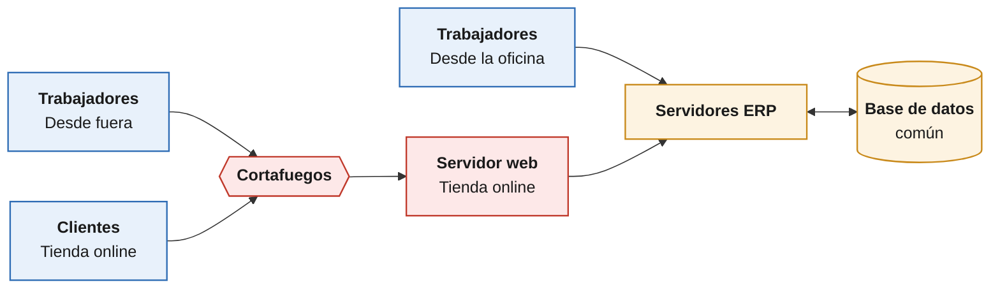
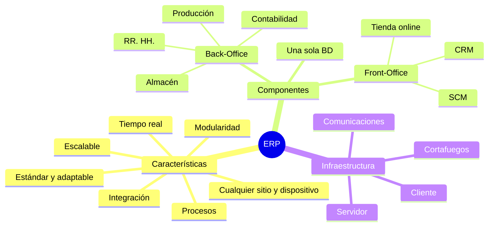

# Definición y módulos de un ERP

**Nombre y apellidos:** Daniel Madrid Mérida

---

## Actividad 2.1

> [!question] Enunciado
> Multitud de autores han definido el concepto de ERP. Algunos de los más utilizados como fuente bibliográfica son: Davenport (1998), Holland y Light (1999), Esteves y Pastor (1999), Kumar y Hillegersberg (2000), Shanks y Seddon (2000), Laudon y Laudon (2000), Orton y Marlene (2004), McGaughey y Gunasekaran (2009).
>
> - Busca las definiciones y compáralas.
> - Busca las definiciones más actuales, añade su referencia siguiendo las normas APA y compárala con las anteriores.

### a) Definiciones de los autores clásicos

| Autor (año)                             | Qué dice que es un ERP                                                                                                                                                                                                       |
| --------------------------------------- | ---------------------------------------------------------------------------------------------------------------------------------------------------------------------------------------------------------------------------- |
| **Davenport (1998)**                    | Un programa que junta toda la información que se mueve por la empresa (cuentas, personal, proveedores, clientes, etc.) en un mismo sitio.                                                                                         |
| **Holland y Light (1999)**              | Un sistema que une los procesos de todos los departamentos, hace que el trabajo fluya mejor, pone a todos a trabajar de la misma forma y permite ver los datos al momento.                                                   |
| **Esteves y Pastor (1999)**             | Un paquete de software hecho de módulos estándar (ventas, producción, personal, finanzas, etc.) que vende un proveedor y que cada empresa puede adaptar a lo que necesita.                                                        |
| **Kumar y van Hillegersberg (2000)**    | Un paquete de software que se puede configurar y que une la información y los procesos dentro de cada departamento y entre departamentos.                                                                                    |
| **Shanks y Seddon (2000)**              | Un paquete de software grande y complicado que une la información de toda la empresa y que cuesta mucho poner en marcha, porque obliga a cambiar la forma de trabajar.                                                       |
| **Laudon y Laudon (2000)**              | Un único sistema con una base de datos común donde están los procesos importantes de la empresa, para que la información llegue a todos sin problemas.                                                                       |
| **Orton y Marlene (2004)**              | Un sistema que une la gestión de todos los recursos de la empresa.                                                                                                                                                           |
| **McGaughey y Gunasekaran (2007/2009)** | Explican el ERP como la evolución del MRP y el MRP II: primero solo se controlaban los materiales y ahora se controla toda la empresa. También lo abren hacia fuera (clientes, proveedores, internet), lo que llaman ERP II. |

**Comparación**

Todas las definiciones coinciden en lo básico, que es también lo que dice el libro: un ERP es un sistema formado por módulos (uno por departamento) que comparten una misma base de datos, para que la información no se repita y llegue a todos.

Las diferencias están en lo que destaca cada autor:

- Esteves y Pastor, Kumar y van Hillegersberg, y Shanks y Seddon lo ven más como un programa: un paquete de software estándar que se configura.
- Davenport, Holland y Light, y Laudon y Laudon lo ven más desde la empresa: lo importante es que los procesos funcionen mejor y que la información circule.
- Shanks y Seddon son los únicos que avisan de lo difícil y caro que es implantarlo.
- McGaughey y Gunasekaran cuentan de dónde viene (del MRP al MRP II, luego al ERP y al ERP II) y cómo ha ido creciendo.

### b) Definiciones actuales

| Fuente | Qué dice que es un ERP |
| --- | --- |
| **Gartner (s. f.)** | Un conjunto de aplicaciones de negocio unidas entre sí que automatizan las tareas de la empresa, tanto las de administración como las de cara al cliente. |
| **Oracle (s. f.)** | El software que usa una empresa para llevar su día a día (contabilidad, compras, proyectos, cadena de suministro, etc.) conectado a una sola fuente de datos. Hoy casi siempre se usa en la nube. |
| **SAP (s. f.)** | Un sistema que gestiona los procesos principales (finanzas, fabricación, compras, servicios, etc.) todo junto y que, gracias a la analítica y a la inteligencia artificial, ayuda a ver lo que pasa en la empresa y a trabajar mejor. |

**Comparación con las clásicas**

- **Lo que no cambia:** sigue siendo un sistema que une todos los departamentos con unos datos comunes.
- **Lo nuevo:**
  - Ahora se usa sobre todo en la nube, pagando por usarlo (SaaS), en lugar de instalarlo en los ordenadores de la empresa.
  - Ya no solo guarda datos: con la analítica y la IA también ayuda a tomar decisiones.
  - Se abre hacia fuera e incluye a clientes, proveedores y socios. Es lo que el libro llama ERP II, III y IV.
- Antes se hablaba de un programa que había que instalar y ahora de una plataforma que conecta toda la empresa con su entorno.

#### Referencias

- Davenport, T. H. (1998). Putting the enterprise into the enterprise system. *Harvard Business Review, 76*(4), 121-131.
- Esteves, J. y Pastor, J. (1999). An ERP lifecycle-based research agenda. En *First International Workshop on Enterprise Management and Resource Planning: Methods, Tools and Architectures (EMRPS'99)* (pp. 359-371). Venecia.
- Gartner. (s. f.). *Enterprise resource planning (ERP)*. Gartner Peer Community. Recuperado el 21 de octubre de 2026, de https://www.gartner.com/peer-community/discussions/enterprise-resource-planning
- Holland, C. P. y Light, B. (1999). A critical success factors model for ERP implementation. *IEEE Software, 16*(3), 30-36.
- Kumar, K. y van Hillegersberg, J. (2000). ERP experiences and evolution. *Communications of the ACM, 43*(4), 22-26.
- Laudon, K. C. y Laudon, J. P. (2000). *Management information systems: Organization and technology in the networked enterprise* (6.ª ed.). Prentice Hall.
- McGaughey, R. E. y Gunasekaran, A. (2007). Enterprise resource planning (ERP): Past, present and future. *International Journal of Enterprise Information Systems, 3*(3), 23-35. https://doi.org/10.4018/jeis.2007070102
- Oracle. (s. f.). *What is ERP?* Recuperado el 21 de octubre de 2026, de https://www.oracle.com/erp/what-is-erp/
- SAP. (s. f.). *What is ERP?* Recuperado el 21 de octubre de 2026, de https://www.sap.com/products/erp/what-is-erp.html
- Shanks, G. y Seddon, P. (2000). Editorial: Enterprise resource planning (ERP) systems. *Journal of Information Technology, 15*(4), 243-244.

## Actividad 2.2

> [!question] Enunciado
> Realiza un resumen y un esquema (lo más visual y atractivo que puedas) de las características, componentes e infraestructura de un ERP.

### Resumen

**Características**

Las dos más importantes son:

- **Modularidad:** el ERP está dividido en módulos y cada uno corresponde a un área de la empresa (ventas, almacén, personal, etc.), pero todos comparten la información.
- **Integración:** los datos se meten una sola vez en una base de datos común, y lo que se apunta en un módulo lo pueden usar los demás.

Además, un ERP suele:

- Estar pensado para los procesos de la empresa, no para departamentos sueltos.
- Funcionar en distintos sistemas y dispositivos, y desde cualquier sitio.
- Servir para cualquier tipo de negocio (estandarización), pero dejando adaptarlo a cada empresa.
- Poder conectarse con cuadros de mando y herramientas BI para sacar informes.
- Dar la información al momento y a cada persona solo lo que le toca ver.
- Poder crecer con la empresa (más módulos, más usuarios, más datos) sin dejar de funcionar bien.

**Componentes**

Un ERP está formado por módulos: contabilidad y finanzas, ventas y marketing, recursos humanos, CRM, compras, almacén, producción, proyectos, comercio electrónico, SCM, SRM, PLM, gestión del conocimiento y TPV. Se dividen en dos grupos:

- **Back-Office:** los que se encargan de lo interno de la empresa (personal, almacén, contabilidad, producción, etc.).
- **Front-Office:** los que tratan con gente de fuera, es decir, clientes y proveedores (CRM, SCM, comercio electrónico, etc.).

**Infraestructura**

- **Cómo funciona por dentro:** cada módulo hace su trabajo y lee y guarda en la misma base de datos.
- **Con qué tecnología:** se usa el modelo cliente-servidor con bases de datos relacionales. Tiene tres partes:
  1. **Cliente:** lo que usa el trabajador; hoy en día basta con el navegador web.
  2. **Comunicaciones:** la red que conecta al usuario con el servidor desde cualquier sitio.
  3. **Servidor:** donde está el ERP de verdad: el programa, la base de datos y su gestor.
- **Cómo se monta:** uno o varios servidores (físicos o virtuales) protegidos por un cortafuegos, que deja entrar a tres tipos de usuarios: los trabajadores desde la oficina, los trabajadores desde fuera y los clientes que compran en la tienda online.

**Infraestructura general de un ERP**:

### Esquema

## Actividad 2.3

> [!question] Enunciado
> Estudia las funcionalidades de los módulos relacionados con la fabricación de productos, como Fabricación, MRP, PLM, Calidad, Trazabilidad.

### Fabricación

Se encarga de organizar y controlar todo lo que pasa en la fábrica.

- Crear las órdenes de fabricación (qué hay que fabricar y cuánto) y seguirlas hasta que se terminan.
- Indicar los pasos para fabricar cada producto: qué máquina se usa, en qué orden y cuánto tarda.
- Repartir el trabajo según las máquinas y trabajadores disponibles.
- Apuntar lo que se ha gastado de verdad: material, horas y piezas defectuosas.
- Calcular cuánto cuesta fabricar cada producto.

### MRP / MRP II

El MRP calcula qué materiales hacen falta, cuántos y cuándo para fabricar lo que se ha pedido, y lo compara con lo que hay en el almacén. El MRP II va un paso más allá y tiene en cuenta también las máquinas, el personal y los costes.

- **Lista de materiales (BOM):** las piezas que lleva cada producto y cuántas.
- **Plan de producción:** qué se va a fabricar y cuándo, según los pedidos y lo que se espera vender.
- **Cálculo de lo que falta:** lo que se necesita, menos lo que ya hay en el almacén y lo que ya está pedido.
- Propone automáticamente los pedidos a proveedores y las órdenes de fabricación.

### PLM

Guarda toda la información de un producto durante toda su vida: desde que se diseña hasta que se deja de vender.

- Tiene en un mismo sitio los planos, especificaciones y documentos del producto.
- Controla las versiones y los cambios que se hacen en el diseño.
- Pasa la lista de materiales del diseño a fabricación.
- Hace que diseño, fábrica, proveedores y calidad trabajen con la misma información.

### Calidad

Comprueba que los materiales y los productos salen como tienen que salir.

- Hacer revisiones al recibir el material, durante la fabricación y al final.
- Apuntar los resultados de cada revisión.
- Gestionar los fallos: rechazar piezas, devolverlas al proveedor y poner medidas para que no se repitan.
- Puntuar a los proveedores según la calidad de lo que mandan.
- Guardar la documentación para certificaciones como la ISO 9001.

### Trazabilidad

Permite saber la historia completa de cada producto: de dónde vienen sus materiales y a quién se ha vendido.

- Identificar cada producto por lotes o números de serie.
- Controlar las fechas de fabricación y caducidad.
- Ver todo el recorrido de un lote: proveedor, fabricación, revisiones de calidad y cliente.
- Si sale un lote defectuoso, saber rápido a quién se le vendió para retirarlo.
