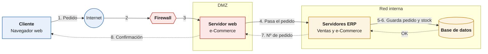

**Nombre y apellidos:** Daniel Madrid Mérida y Sergio Casado Sanchez

---

## Parte 1. El viaje de los datos

> [!question] Escenario elegido
> Escenario 1. Compra en una tienda online
>
> Un cliente realiza un pedido de un producto desde la tienda e-Commerce de la empresa.

### 1. ¿Desde dónde empieza y quién lo hace?

Lo empieza un cliente desde su casa, con el móvil o el ordenador. Entra en la tienda online con el navegador, así que no tiene que instalar nada. Todo va por internet.

### 2. Recorrido paso a paso de componentes

1. El cliente mete el producto en el carrito y le da a "Confirmar pedido".
2. El pedido llega al firewall de la empresa, que mira si es una visita normal a la tienda y la deja pasar a la DMZ.
3. En la DMZ está el servidor web de la tienda, que recoge el pedido.
4. El servidor web se lo pasa a los servidores ERP. Para eso vuelve a pasar por el firewall, porque el ERP está en la red interna.
5. El ERP mira si hay stock y crea el pedido.
6. El pedido se guarda en la base de datos y se resta el stock. Como la base de datos es la misma para todos, el almacén y facturación ya lo ven.
7. El ERP le devuelve al servidor web el número de pedido.
8. La tienda le enseña al cliente "Pedido realizado" y le manda un correo.

### 3. Qué hace cada componente

| Componente | Qué hace aquí |
| --- | --- |
| **Cliente (navegador)** | Hace el pedido y recibe la confirmación. |
| **Firewall** | Deja entrar a la tienda pero no a la red interna. |
| **DMZ** | Zona separada donde está lo que se ve desde internet. Si atacan la tienda, no llegan al ERP. |
| **Servidor web / e-Commerce** | Muestra la tienda y pasa el pedido al ERP. |
| **Servidores ERP** | Procesan el pedido y comprueban el stock. |
| **Base de datos** | Guarda el pedido, el cliente y el stock. |

Los usuarios internos y remotos no intervienen, porque el pedido lo hace un cliente desde fuera.

### 4. Dónde se guarda y cómo vuelve el resultado

Se guarda en la base de datos, que está dentro de la red de la empresa, protegida por el firewall. La respuesta hace el camino al revés: base de datos, ERP, servidor web y cliente.

### 5. Esquema

Flechas continuas: el pedido. 
Discontinuas: la respuesta.

## Parte 2. Detecta el fallo

> [!question] Escenario elegido
> Escenario 4. Los pedidos no se registran
>
> Los clientes pueden realizar pedidos desde la tienda online, pero estos no aparecen registrados en la base de datos de la empresa.

### 1. ¿Qué está pasando?

Los clientes compran sin problema, pero los pedidos no llegan a la base de datos. El almacén no los prepara y el cliente se queda esperando. Como la tienda funciona, el fallo está entre el servidor web y la base de datos.

### 2. Posibles causas

- **Firewall:** puede estar bloqueando el paso del servidor web al ERP.
- **Servidor web:** puede fallar al enviar los pedidos al ERP.
- **Servidores ERP:** el servicio que recibe los pedidos puede estar caído.
- **Base de datos:** puede estar llena o no dejar guardar.

### 3. ¿Por qué pensamos eso?

Porque son los componentes que están en el camino del pedido después de la tienda. Lo de antes funciona, ya que los clientes pueden comprar. Además, si un cambio en el firewall corta solo el paso hacia la red interna, la tienda se sigue viendo bien aunque los pedidos no lleguen.

### 4. ¿Qué miraríamos primero?

Haríamos un pedido de prueba y miraríamos los registros del servidor web para ver si da error al enviarlo. Si es así, revisaríamos el firewall, luego que el ERP esté funcionando y por último si la base de datos tiene espacio.

### 5. Solución

Arreglar lo que falle: corregir la regla del firewall, reiniciar el servicio o liberar espacio en la base de datos. Después, meter a mano los pedidos perdidos y avisar a los clientes. Para que no vuelva a pasar, la tienda solo debería confirmar el pedido cuando el ERP diga que lo ha guardado.

## Parte 3. Reflexión final

> [!question] Pregunta
> ¿Por qué es importante que una empresa disponga de una infraestructura ERP bien diseñada, organizada y protegida?

Porque con un ERP toda la empresa depende del mismo sistema. Si falla, falla todo a la vez: los trabajadores no pueden trabajar, no se preparan pedidos y no se factura.

Si los pedidos no se registran, se pierden ventas y clientes, porque nadie vuelve a comprar en una tienda que no le manda lo que ha pagado. Si todo está bien organizado, es más fácil encontrar el fallo y arreglarlo rápido.

Y los datos de los clientes tienen que estar protegidos. Para eso están el firewall y la DMZ, que no dejan llegar a la base de datos desde fuera. Si se roban esos datos, la empresa tiene problemas legales y pierde la confianza de los clientes. También hacen falta copias de seguridad por si se pierde algo.

---

### Referencias

- Libro de la asignatura *Sistemas de Gestión Empresarial*, apartado 2.2.4 "Infraestructura" y figura 2.3 (págs. 42-43).
- Apuntes de clase.
