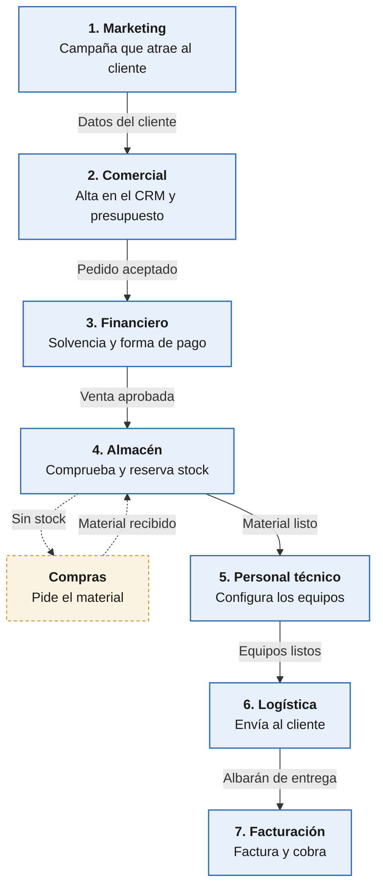

# Ejercicio 1 · Departamentos y flujo de información en un proceso de venta

**Nombre y apellidos:** Daniel Madrid Mérida

---

### 1. Lectura y análisis

Una empresa vende a un cliente un equipamiento informático que tiene que **preparar y configurar** antes de entregarlo. Esa única venta exige la **cooperación coordinada** de varios departamentos:

| Departamento | Función en el proceso |
| --- | --- |
| **Marketing** | Lanza la campaña que despierta el interés del cliente por el producto. |
| **Comercial** | Da de alta al cliente nuevo en el **CRM**, elabora el presupuesto (equipo + servicios de configuración y puesta en marcha) y se lo hace llegar. |
| **Financiero** | Si el cliente acepta, estudia su **solvencia** y fija la forma de pago y las condiciones de la operación. |
| **Almacén** | Comprueba con su control de *stock* que hay material; si no lo hay, lo pide a Compras. |
| **RR. HH. / Dpto. de proyectos (personal técnico)** | Asigna, según su disponibilidad, el técnico que configurará el equipo. |
| **Logística** | Envía el equipo ya preparado al cliente. |
| **Contabilidad / Facturación** | Emite la factura, registra los apuntes contables y hace las gestiones de cobro. |

**Momentos en los que se comparte información entre áreas:**

1. **Marketing → Comercial:** los datos del cliente interesado (*lead*) que ha captado la campaña.
2. **Comercial → Cliente → Financiero:** el presupuesto y, si se acepta, el pedido con los datos del cliente ya registrados en el CRM.
3. **Financiero → Almacén y RR. HH./Técnico:** la operación aprobada y sus condiciones de pago; a partir de aquí se puede preparar el pedido.
4. **Almacén → Compras** (si falta material) y **Almacén → Técnico:** qué material hay y cuándo está disponible para configurarlo.
5. **Técnico → Logística:** aviso de que el equipo está configurado y listo para enviar.
6. **Logística → Facturación:** confirmación de envío y entrega (albarán), que da pie a facturar y cobrar.
7. **Todos → base de datos común:** cada paso añade transacciones al sistema, que el ERP recoge y consolida para todos los departamentos y para la dirección.

### 2. Esquema del proceso de venta

**Secuencia en texto:**

1. **Marketing** lanza una campaña → un cliente muestra interés → pasa sus datos a Comercial.
2. **Comercial** da de alta al cliente en el CRM y le envía el **presupuesto** → el cliente lo acepta.
3. **Financiero** comprueba la **solvencia** y fija la **forma de pago** → aprueba la operación.
4. **Almacén** comprueba el *stock*; si no hay, **Compras** lo pide al proveedor → material disponible.
5. **RR. HH. / Dpto. técnico** asigna un técnico, que **configura** los equipos → listos para enviar.
6. **Logística** prepara y **envía** el pedido al cliente → genera el albarán de entrega.
7. **Contabilidad y facturación** emite la **factura**, registra los apuntes contables y **cobra**.

En todos los pasos la información se guarda en la **base de datos común del ERP**, de modo que cualquier departamento consulta el estado del pedido sin pedirlo a otro.

### 3. Caso práctico: «Un cliente compra un equipo informático»

Un cliente pide **varios ordenadores** que hay que preparar, configurar y enviar a su domicilio.

| Departamento | ¿Qué tarea realiza? | ¿Qué información necesita o transmite? |
| --- | --- | --- |
| **Marketing** | Diseña la campaña (web, redes, correo) que atrae al cliente y recoge su solicitud de información. | **Transmite** a Comercial los datos de contacto del cliente y qué producto le interesa. **Necesita** los resultados de ventas para medir si la campaña funciona. |
| **Comercial** | Atiende al cliente, lo da de alta en el CRM, define la configuración de los ordenadores y elabora el presupuesto. | **Necesita** los datos del cliente, el catálogo, los precios y el stock disponible. **Transmite** el presupuesto al cliente y, una vez aceptado, el pedido (modelos, unidades, configuración, dirección de entrega) al resto de departamentos. |
| **Financiero** | Estudia la solvencia del cliente y decide la forma de pago (al contado, aplazado, financiado) y si se aprueba la operación. | **Necesita** los datos fiscales del cliente, su historial de pagos y el importe del pedido. **Transmite** la aprobación y las condiciones de pago a Almacén, al dpto. técnico y a Facturación. |
| **Almacén** | Comprueba si hay los ordenadores y componentes pedidos, los reserva y, si falta algo, lanza la orden de compra. | **Necesita** el pedido aprobado (modelos y unidades). **Transmite** la disponibilidad del material al técnico, la orden de compra a Compras/proveedor y actualiza el stock. |
| **Personal técnico / RR. HH.** | RR. HH. o el dpto. de proyectos asigna un técnico según su disponibilidad; el técnico instala el sistema operativo y el software y configura los equipos. | **Necesita** la configuración pedida por el cliente, la fecha prevista y el material disponible. **Transmite** que los equipos están listos y las horas de trabajo empleadas (para costes y nóminas). |
| **Logística** | Embala los equipos, organiza el transporte (propio o con una empresa de mensajería) y los entrega en el domicilio del cliente. | **Necesita** la dirección y la fecha de entrega y el aviso de que el pedido está listo. **Transmite** el albarán y la confirmación de entrega (seguimiento del envío). |
| **Contabilidad y facturación** | Emite la factura, registra los apuntes contables (venta, IVA, salida de stock) y controla el cobro. | **Necesita** el pedido, los precios, las condiciones de pago y la confirmación de entrega. **Transmite** la factura al cliente y los datos económicos a dirección (ingresos, cobros pendientes). |

**¿Cómo facilitaría un ERP la coordinación?**

Con un ERP todos estos departamentos trabajan sobre **los mismos datos**, porque cada uno usa un **módulo** (CRM, finanzas, almacén, RR. HH., logística, contabilidad) conectado a una **base de datos común**. El pedido se introduce **una sola vez**, en Comercial, y desde ahí:

- Financiero lo ve al instante para aprobarlo, sin esperar un correo o una hoja de cálculo.
- Almacén recibe el pedido aprobado, **reserva el stock automáticamente** y, si falta material, el sistema puede **generar la orden de compra**.
- El dpto. técnico recibe la **orden de trabajo** con la configuración exacta y Logística sabe cuándo estará listo el pedido.
- Al confirmar la entrega, la **factura se genera a partir del albarán** y los apuntes contables se registran solos.

Así se evitan datos duplicados o contradictorios, se reducen los tiempos de espera y los errores manuales, y cualquiera puede consultar **en qué punto está el pedido** (trazabilidad). Además, la dirección obtiene **información consolidada** en tiempo real para tomar decisiones.

### 4. Preguntas de comprensión y reflexión

#### 4.1 ¿Qué consecuencias podría tener que un departamento no compartiera la información a tiempo?

El proceso de venta es una **cadena**: cada departamento necesita lo que produce el anterior, así que un retraso o un dato que no llega afecta a todos los que vienen después. Por ejemplo:

- Si **Comercial** no pasa el pedido a tiempo, Almacén no reserva el material y otro cliente puede llevarse esas unidades.
- Si **Almacén** no avisa de que falta stock, el técnico no puede configurar los equipos y la entrega se retrasa.
- Si **Financiero** no comunica que el cliente no es solvente, se puede enviar un pedido que luego no se cobra.
- Si **Logística** no confirma la entrega, Facturación no emite la factura y el cobro se retrasa, lo que afecta a la tesorería.

El resultado son **retrasos, errores, costes extra** (envíos urgentes, devoluciones, impagos), decisiones tomadas con datos desfasados y, sobre todo, un **cliente insatisfecho**, que es justo lo que se intenta evitar con la fidelización (CRM).

#### 4.2 ¿Cómo puede ayudar un sistema ERP a evitar estos problemas?

- **Base de datos común:** la información se registra una vez y está disponible al instante para todos los módulos; nadie depende de que otro «se acuerde» de enviarla.
- **Automatización del flujo de trabajo:** cuando un departamento termina su paso, el ERP lanza el siguiente (aviso al almacén, orden de trabajo, factura desde el albarán).
- **Alertas y control:** avisos de stock bajo, pedidos bloqueados por riesgo de impago o entregas retrasadas.
- **Trazabilidad:** se ve en qué estado está cada pedido y quién lo tiene, así que los cuellos de botella se detectan pronto.
- **Información fiable para la dirección:** informes consolidados y en tiempo real para tomar decisiones.

Estos son, precisamente, los tres objetivos básicos de un ERP: acceso a la información **inmediato, confiable y preciso**; **optimización de los procesos** eliminando operaciones innecesarias; y **compartir la información** entre departamentos.

#### 4.3 ¿Qué ventajas ofrece un ERP frente a utilizar programas independientes para cada departamento?

Si cada departamento usa un programa distinto (uno de facturación, una hoja de cálculo de stock, otro de nóminas…), cada uno tiene **su propia base de datos con su propio esquema**. La información hay que pasarla a mano o con exportaciones entre programas, lo que provoca duplicidades, errores de transcripción y retrasos.

Ventajas del ERP:

| Programas independientes | ERP |
| --- | --- |
| Cada programa con su base de datos | **Base de datos única** y compatible para todos los módulos |
| Datos duplicados y a veces contradictorios (el mismo cliente con dos direcciones) | **Un único dato** para toda la empresa |
| La información se traspasa a mano o por correo | Flujo **automático** entre departamentos |
| Cada aplicación tiene su interfaz, su proveedor y su mantenimiento | **Un solo sistema** que mantener y aprender, con una interfaz homogénea |
| Difícil obtener una visión global del negocio | **Información consolidada** para la toma de decisiones |
| Integrar programas de distintos fabricantes es caro y frágil | **Integración nativa**; se añaden módulos según crece la empresa (modularidad) |

Por eso un ERP es algo más que el conjunto de sus módulos: su valor está en la **interoperabilidad** entre ellos.

#### 4.4 ¿Crees que todas las empresas necesitan un ERP completo? ¿En qué situaciones podría ser suficiente utilizar soluciones más sencillas?

**No.** Todas las empresas tienen que ejecutar sus procesos (presupuestar, comprar, entregar, facturar, cobrar), pero no todas necesitan un ERP **completo** con todos sus módulos. La decisión depende del **tamaño**, del **volumen de operaciones** y de **qué tareas se hacen en la propia empresa y cuáles se externalizan**.

Situaciones en las que basta con soluciones más sencillas:

- **Autónomos y micropymes** con pocas operaciones: por ejemplo, un autónomo que prepara el presupuesto, compra al mayorista, configura y entrega él mismo y tiene **externalizadas** la contabilidad y la gestión de personal. No necesita los módulos de RR. HH. ni de contabilidad; le basta con un programa de **facturación y stock** que pueda **exportar los datos** a su gestoría.
- **Empresas con un solo proceso sencillo** (un pequeño comercio, un profesional de servicios): les basta una **hoja de cálculo bien organizada**, un TPV o un CRM sencillo.
- **Empresas en crecimiento:** pueden empezar con un **ERP modular en la nube (SaaS)**, contratando solo los módulos que necesitan (por ejemplo, ventas y facturación) y añadiendo otros más adelante. Así evitan el coste y la complejidad de implantar un ERP completo *On-Premise*.

En cambio, un ERP completo compensa cuando hay **varios departamentos**, mucho volumen de pedidos, stock y personal propios y muchos traspasos de información, como en la empresa del caso práctico. En resumen, hay que elegir **el ERP adecuado al modelo y al tamaño del negocio**, usando solo los módulos de las funciones que no se subcontratan.
