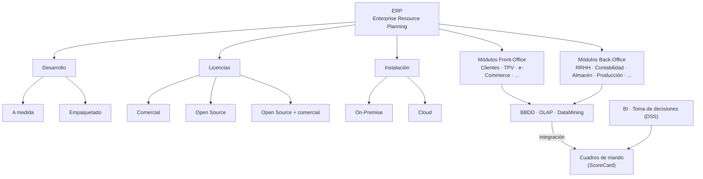
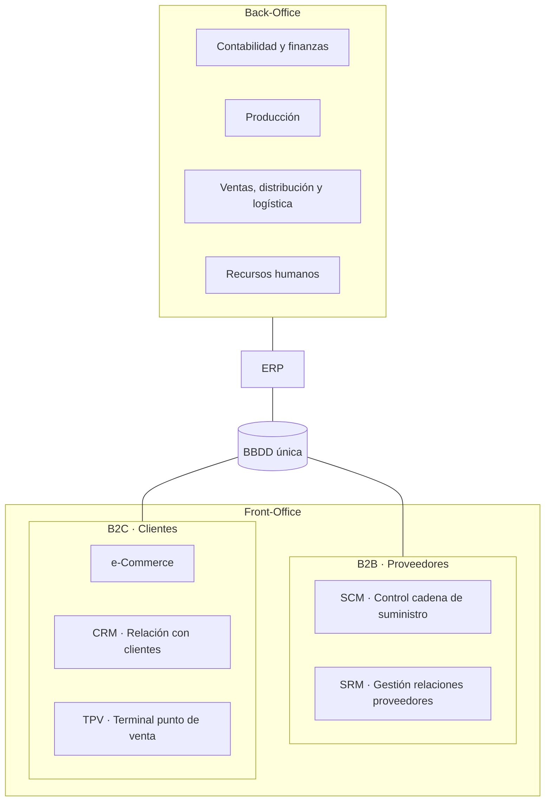
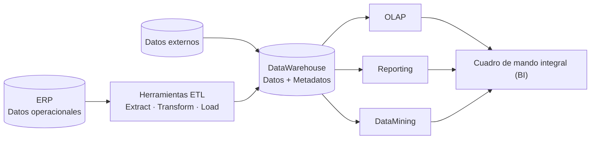

# 2 · ERP (Enterprise Resource Planning)

> [!info] Asignatura
> [[DAM/Sistema_de_Gestion_Empresarial/Indice|Sistema de Gestión Empresarial]] · Tema 2 · ERP (Enterprise Resource Planning)
> Fuente original: [[UD2. ERP (Enterprise Resource Planning).pdf]] (capítulo 2 del libro de la asignatura)

> [!abstract] Idea central de la unidad
> Un **ERP** es un sistema **integrado** y **modular** que reúne en una **única base de datos** la información de todos los departamentos de la empresa. Así se automatizan los procesos, la información fluye sola entre departamentos y la dirección puede tomar decisiones con datos fiables. A partir de esos datos, la **inteligencia de negocio (BI)** extrae conocimiento (ETL → DataWarehouse → OLAP / DataMining → KPI → cuadro de mando).

## Índice del tema

- [[#Objetivos del tema]]
- [[#Mapa conceptual]]
- [[#Glosario del tema]]
- [[#2.1 Introducción. ¿Qué es un ERP?]]
	- [[#2.1.1 Ejemplo de un proceso de negocio]]
	- [[#2.1.2 Origen y evolución del concepto ERP]]
- [[#2.2 Características, componentes e infraestructura de un ERP]]
	- [[#2.2.1 Características de un ERP]]
	- [[#2.2.2 Componentes de un ERP]]
	- [[#2.2.3 Funcionalidades de los principales módulos]]
	- [[#2.2.4 Infraestructura]]
- [[#2.3 Soluciones On-Premise y Cloud. Licenciamiento]]
	- [[#2.3.1 Tipos de licencia]]
- [[#2.4 Tipos, ventajas e inconvenientes de una solución ERP]]
	- [[#2.4.1 To do or to buy (or to rent)]]
	- [[#2.4.2 Importancia de los ERP. La información y el poder]]
	- [[#2.4.3 Dificultades de implementar un ERP]]
- [[#2.5 El mercado actual]]
	- [[#2.5.1 Soluciones propietarias]]
	- [[#2.5.2 Soluciones Open Source]]
	- [[#2.5.3 Tecnologías más utilizadas]]
- [[#2.6 La inteligencia de negocio (BI)]]
	- [[#2.6.1 ETL]] · [[#2.6.2 OLAP]] · [[#2.6.3 DataWarehouse]] · [[#2.6.4 DataMining]] · [[#2.6.5 KPI]] · [[#2.6.6 BSC]]
- [[#Actividades propuestas]]
- [[#Esquema resumen de conceptos clave]]

---

## Objetivos del tema

- Comprender el **concepto de ERP**, sus **componentes modulares** y cómo se adapta cada uno a los distintos departamentos de la empresa.
- Estudiar las **opciones de implementación** de un ERP: soluciones **empaquetadas** o **desarrollos a medida**.
- Advertir las **ventajas e inconvenientes** de implantar un ERP.
- Conocer las **tendencias del mercado** actual y los **tipos de licencias**.
- Diferenciar las soluciones **On-Premise** y **Cloud**.
- Relacionar los conceptos **ERP, ETL, OLAP, DataWarehouse, DataMining, ScoreCard y BI**.
- Reconocer las principales soluciones **propietarias** y **Open Source** actuales.

## Mapa conceptual

> [!tip] Cómo leer el mapa
> Del ERP salen tres decisiones que toda empresa tiene que tomar: **cómo se desarrolla** (a medida o empaquetado), **con qué licencia** (comercial, Open Source o mixta) y **dónde se instala** (en casa o en la nube). Por debajo, los datos que recogen los módulos alimentan la **BI** y los **cuadros de mando**.

## Glosario del tema

| Término | Significado |
| --- | --- |
| **B2B** (*Business to Business*) | Transacciones comerciales **entre empresas**. |
| **B2C** (*Business to Customer*) | Transacciones entre empresas y **consumidores finales**. |
| **Back-Office** | Actividades administrativas **internas** de la empresa, que la mantienen en funcionamiento. |
| **Front-Office** | Actividades realizadas **de cara al cliente**. Son las que generan los beneficios. |
| **BigData** | Procesamiento de volúmenes **muy grandes** de datos de todo tipo. |
| **Cloud Computing** | Computación en la nube: servicios de hardware y software proporcionados **a través de internet**. |
| **e-commerce** | Comercio electrónico: compra y venta a través de internet. |
| **IoT** (*Internet of Things*) | Internet de las cosas: conexión de todo tipo de dispositivos electrónicos a través de internet. |
| **Know-how** | "Saber hacer": conocimientos **no protegidos** de una organización que le dan ventaja frente a la competencia. |
| **On-Premise** | Instalación **en local**: los servicios de computación están en la **propia empresa**. |
| **SaaS** (*Software as a Service*) | Software como servicio: el proveedor ofrece **licencias de uso** de un software a través de internet. |
| **ETL** (*Extract, Transform and Load*) | Herramientas de **extracción, transformación y carga** de datos (en castellano, ETC). |

> [!tip] Ver también
> Más acrónimos (TPS, MIS, DSS, SCM, PLM...) en [[1.3 - Sistemas de información de gestión#Acrónimos|1.3 · Acrónimos]] y en el [[DAM/Sistema_de_Gestion_Empresarial/Tema 1/Glosario|Glosario del Tema 1]].

---

## 2.1 Introducción. ¿Qué es un ERP?

En el Tema 1 vimos muchos sistemas de información que mecanizan procesos **estratégicos, operativos y de gestión**: facturación, nóminas, contabilidad, control de asistencia, producción, inventario, logística, gestión de clientes...

El problema es que los procesos de negocio suelen ser **multifuncionales**: implican a **varios departamentos**. Si cada departamento usa **su propio software con su propia base de datos**, la información no pasa sola de uno a otro y alguien tiene que transmitirla a mano. Eso es lento y provoca errores.

> [!example] Analogía: la oficina sin ERP
> Imagina una empresa en la que cada departamento apunta las cosas en **su propia libreta**. Comercial vende un portátil y lo apunta en la suya; luego tiene que llamar a almacén para que lo apunten en la suya, y a contabilidad para que lo apunten en otra. Si alguien se olvida de avisar, las libretas ya no coinciden.
> Un ERP es como cambiar todas esas libretas por **una pizarra compartida** que todos ven: lo que escribe uno, los demás lo ven al momento.

Por eso estos sistemas independientes se han ido sustituyendo por los **ERP**.

> [!definition] ERP (Enterprise Resource Planning)
> En castellano, **sistema de planificación de recursos empresariales**. Es un sistema de información **integrado**, compuesto por **módulos** que se corresponden con las funciones departamentales de la empresa, y que utiliza una **base de datos común**. Permite:
> - **automatizar** los procesos,
> - **compartir** la información entre departamentos y gestionar el **flujo de trabajo**,
> - dar a los directivos **información consolidada** para tomar decisiones informadas.

- El software de cada módulo es distinto, pero su **estructura lógica** (el esquema de la base de datos) es **compatible con la base de datos común**.
- Un ERP es **más que la suma de sus módulos**, precisamente por esa **interoperabilidad**. Por eso es mejor que elegir programas sueltos de distintos fabricantes para cada departamento: no usarían la misma base de datos ni el mismo esquema, y el flujo de información entre departamentos no se podría automatizar.

> [!important] Recuerda: objetivos básicos de un ERP
> 1. **Acceso a la información** de la empresa de forma **inmediata, confiable y precisa**.
> 2. **Optimización de los procesos** de negocio y **eliminación de operaciones innecesarias**.
> 3. **Compartición de información** entre distintos departamentos.

### 2.1.1 Ejemplo de un proceso de negocio

**Situación:** una empresa ha vendido a un cliente un equipo informático que tiene que preparar y configurar antes de entregárselo. En esa venta cooperan varios departamentos:

| Paso | Departamento | Qué hace |
| --- | --- | --- |
| 1 | **Marketing** | Lanza una campaña; un cliente muestra interés por un producto. |
| 2 | **Comercial** | Da de alta al cliente en el **CRM** y le envía un presupuesto (equipo + configuración). |
| 3 | **Financiero / Contabilidad** | Comprueba la **solvencia** del cliente y fija la **forma de pago**. |
| 4 | **RRHH / Dpto. técnico (proyectos)** | Asigna el técnico que configurará el equipo, según su disponibilidad. |
| 5 | **Almacén** | Comprueba el **stock**; si no hay material, se pide a compras. |
| 6 | **Logística** | Envía el equipo al cliente. |
| 7 | **Facturación / Contabilidad** | Factura y registra los **apuntes contables**. |

> [!note] La clave
> Cada paso añade **transacciones** a la base de datos que afectan a todos los departamentos implicados. El ERP lo **recoge y consolida todo** en un único sitio.

**¿Y en una pyme o un autónomo?** En las empresas pequeñas los "departamentos" se difuminan: una sola persona hace el presupuesto, compra el material al mayorista, configura el equipo, lo entrega y lo cobra. Aun así, los procesos existen y el ERP permite gestionarlos **desde un único punto**. Solo hay que elegir el ERP adecuado al **tamaño** del negocio y usar los **módulos que necesite**: por ejemplo, un autónomo seguramente no necesita los módulos de RRHH ni de contabilidad porque los tiene **externalizados** (gestoría); le basta con poder **exportar los datos** a su gestor.

### 2.1.2 Origen y evolución del concepto ERP

| Generación | Año / origen | Qué añade |
| --- | --- | --- |
| **MRP II** | Anterior a 1990 | Gestión de **fabricación y finanzas**. |
| **ERP** | 1990, término acuñado por **Gartner** | Supera al MRP II e incluye otras funcionalidades **internas** (todos los procesos de la empresa). |
| **ERP II** | 2000, Gartner, artículo *"ERP is dead. Long live ERP II"* | Llega el **e-commerce**: gestiona también la relación con el **entorno** (proveedores y administraciones) con **SRM** y **PLM**. |
| **ERP III** | — | Integra a los **clientes**: herramientas de colaboración interna y externa, **nube**, **SaaS**, internet para transacciones sin contacto, **redes sociales**, **IoT** y **C-Commerce**. |
| **ERP IV** | Actualidad | Amplía el ecosistema a **socios, competidores** y otros actores y, sobre todo, usa **BI** e **inteligencia artificial (IA)**. |

> [!tip] Truco para recordarlo
> Cada generación **amplía el círculo** de quién participa: ERP → solo **dentro** de la empresa; ERP II → + **proveedores**; ERP III → + **clientes**; ERP IV → + **todo el ecosistema** e IA.

---

## 2.2 Características, componentes e infraestructura de un ERP

Para que una solución de gestión se pueda considerar un ERP debe tener una serie de características y, sobre todo, abarcar el **mayor número posible de funcionalidades** que se necesitan en una empresa.

### 2.2.1 Características de un ERP

Las **dos principales** son la **modularidad** y la **integración**:

> [!definition] Modularidad
> Cada **módulo** se corresponde con un **área funcional** de la empresa. Aunque use un paquete de software distinto, **comparte la información** con el resto de módulos.

> [!definition] Integración
> Los datos se introducen **una única vez** en una **base de datos central** accesible desde todos los módulos. Así, la información que genera un módulo se **reutiliza** en otro.

> [!example] Analogía: las piezas de LEGO
> La **modularidad** es que puedas comprar las piezas que necesites (solo ventas y almacén, por ejemplo) y añadir más después. La **integración** es que todas las piezas **encajan entre sí** porque comparten la misma base (la base de datos común).

Otras características generales de los ERP:

- Están **orientados a los procesos** empresariales.
- Suelen ser **multiplataforma**.
- Permiten el acceso desde **múltiples localizaciones** y con distintos **dispositivos**.
- **Estandarización**: se diseñan según el funcionamiento estándar de las empresas, así que sirven para **cualquier sector**.
- **Adaptabilidad**: permiten cierta adaptación a las particularidades de cada empresa.
- Son **integrables** con sistemas que dan la información a los cuadros de mando (**Dashboard** y **ScoreCard**) y a la **BI**.
- Gestionan la información **en tiempo real** y la ponen a disposición de la organización de forma **selectiva y jerárquica** (cada uno ve lo que le toca).
- Son **escalables**: crecen según las necesidades (módulos, usuarios, tamaño de la BBDD, número de peticiones...) **sin comprometer su funcionamiento**.

### 2.2.2 Componentes de un ERP

Un ERP se compone de **módulos**. Enumerarlos todos es casi imposible, pero los principales fabricantes ofrecen, además de la instalación base, módulos para estos departamentos o funciones:

- Contabilidad y finanzas.
- Comercial y marketing.
- Recursos humanos.
- Relaciones con el cliente (**CRM**).
- Compras y proveedores.
- Gestión de almacén.
- Gestión de la producción.
- Gestión de proyectos.
- Comercio electrónico (**B2B** y **B2C**).
- Optimización de la cadena de suministros (**SCM**).
- Gestión de relaciones con proveedores (**SRM**).
- Gestión de vida del producto (**PLM**).
- Gestión del conocimiento (**KMS**, *Knowledge Management System*).
- Terminal punto de venta (**POS** o **TPV**, *Point of Sale*).

Estos módulos se agrupan en **dos grandes bloques**:

| | **Back-Office** | **Front-Office** |
| --- | --- | --- |
| Qué gestiona | Procesos **internos** | Relación con el **exterior** (clientes y proveedores) |
| Módulos | RRHH, almacén, contabilidad y finanzas, producción, ventas/distribución/logística | **B2B**: SCM, SRM (proveedores) · **B2C**: e-Commerce, CRM, TPV (clientes) |

> [!note] ERP frente a CRM
> Prácticamente **todos los ERP incluyen un módulo CRM**. La diferencia de enfoque:
> - El **CRM** está enfocado al **cliente** y a **aumentar las ventas**.
> - El **ERP** está orientado al **negocio**: optimizar recursos y procesos y, por tanto, **reducir costes**.

> [!tip] Sabías que...
> Según el fabricante y su especialización, existen módulos o *plugins* para casi **cualquier proceso de negocio** que se pueda imaginar.

### 2.2.3 Funcionalidades de los principales módulos

Es una relación **no exhaustiva**: cada fabricante organiza sus módulos a su manera, pero sirve para entender qué hace cada uno.

#### A) Contabilidad y finanzas

- **Automatiza las operaciones contables.**
- Se alimenta sobre todo de los módulos de **ventas** (facturar a clientes) y **compras** (pagar a proveedores).
- Gestiona **impuestos**, **cuentas bancarias**, y suele ofrecer **contabilidad analítica** y muchos **informes**.
- Tiene que seguir el **plan contable local** (en España, el Plan General Contable).

#### B) Comercial (y marketing)

- También llamado **módulo de ventas y facturación**.
- Gestiona desde que aparece una **oportunidad** hasta el **cierre de la venta** y la **facturación**: presupuestos, visitas, llamadas...
- Elabora **listas de precios**, **descuentos** y **campañas** (en colaboración con marketing).
- Por la importancia del marketing y sus nuevos canales, a menudo hay **módulos específicos** de marketing.

#### C) Recursos humanos (RRHH)

- Gestión del personal en sentido amplio: **selección y contratación**, política de **remuneraciones y beneficios sociales**.
- Elaboración de **nóminas** y cumplimiento normativo.
- Control de **asistencia, permisos y vacaciones**.
- Da una visión global del **rendimiento y los costes** de cada departamento.

#### D) CRM

- Controla **todo tipo de contactos con los clientes** (visto en [[1.5 - La fidelización del cliente. Concepto CRM|1.5 · Concepto CRM]]).
- Existe como solución **independiente**, pero la mayoría de ERP lo incluyen.
- Se puede **solapar** con los módulos de facturación, comerciales, ventas y marketing.

#### E) Compras y proveedores

- A veces incluye el almacén.
- Controla **proveedores**, **listas de precios**, **órdenes de compra**, reglas de contratación y métodos de **reposición** (es el "espejo" del módulo de ventas).
- Contratos con proveedores, negociación de condiciones, **seguimiento de pedidos** y control de entrega.

#### F) Almacén y logística

- Control de las **entregas** de proveedores, **existencias**, **reabastecimiento**, **rotación** del inventario, **stock** y **traspasos** entre almacenes.
- Gestiona la **logística** (propia o subcontratada) con módulos de conexión con transportistas.

#### G) Otras aplicaciones de interés

Interesantes para una pyme y desde el punto de vista docente:

- Sitio web.
- Parte de horas.
- Fabricación.
- MRP II.
- PLM.
- Calidad.
- Comercio electrónico.
- eLearning.

### 2.2.4 Infraestructura

- **Desde el punto de vista funcional**: estructura **modular**. Cada módulo tiene una función concreta y se nutre de una **base de datos central** a la vez que la alimenta.
- **Desde el punto de vista tecnológico**: los ERP actuales se basan en una **estructura cliente-servidor** sobre **bases de datos relacionales**.

Aunque existen soluciones **monousuario** (instaladas en un solo equipo), el objetivo de un ERP es ser **multiusuario**. Una infraestructura distribuida tiene **tres componentes**:

| Componente | Qué es |
| --- | --- |
| **a) Módulo cliente** | *Plugin* más o menos pesado que el usuario ejecuta en su dispositivo. Hoy la tendencia es acceder con un **navegador web** (**cliente ligero**); ya no se usan los **clientes pesados**, que se repartían la "inteligencia" con el servidor. |
| **b) Infraestructura de comunicaciones** | Permite que el cliente se comunique con el servidor desde **cualquier dispositivo y ubicación**. |
| **c) Módulo servidor** | Uno o varios módulos con la **inteligencia del ERP**: dan la información que pide el cliente. Incluye el **lenguaje de programación**, la **base de datos** y el **SGBD**. |

> [!example] Analogía: el restaurante
> El **cliente ligero** (navegador) es el comensal que solo pide del menú; el **servidor** es la cocina, donde se hace todo el trabajo; las **comunicaciones** son el camarero que lleva los pedidos y los platos. Un **cliente pesado** sería un comensal que se tiene que cocinar parte del plato en su mesa.

La estructura cliente-servidor puede tener **una o varias capas**:

- Navegador web ⇄ Aplicación en servidor.
- Navegador web ⇄ Web intermedia ⇄ Aplicación en servidor/es.

Cuantas más capas, más se distribuyen los servicios entre **servidores distintos**. De forma general, la infraestructura de un ERP (figura 2.3 del libro) tiene:

1. **Uno o varios servidores**, físicos o virtuales, que albergan el ERP y la **base de datos**.
2. Un **sistema de comunicaciones protegido por un cortafuegos (firewall)** que permite:
	- el acceso de los usuarios desde la **red interna**;
	- el acceso de los usuarios desde el **exterior a la intranet**;
	- el acceso de los **clientes al módulo de e-Commerce** desde internet. El servidor web de la tienda suele estar en una **DMZ** (zona desmilitarizada), separado de la red interna.

---

## 2.3 Soluciones On-Premise y Cloud. Licenciamiento

En una instalación cliente-servidor se pueden plantear estas opciones:

- En **servidores propios** (físicos o virtuales) en la **sede de la empresa**.
- En servidores físicos o virtuales, propios o alquilados, exclusivos o compartidos, **en la sede de un proveedor**. Antes se conocía como **housing** y **hosting**.
- **Uso de la infraestructura del proveedor**: él instala y mantiene una instancia del ERP para uso exclusivo de la empresa.

Teniendo en cuenta **dónde está** y **quién se responsabiliza** de cada componente, se reducen a **dos grandes tipos**:

| | **On-Premise** | **Cloud (SaaS)** |
| --- | --- | --- |
| Dónde está | Infraestructura **del cliente** | Máquinas **del proveedor** |
| Quién lo mantiene | La propia empresa | El **proveedor** (instala, mantiene y gestiona) |
| Qué hace el cliente | Todo: servidores, personal técnico, mantenimiento | Solo **acceder al servicio** y pagar |
| Pago | Licencias + infraestructura | **Pago por uso** |
| Uso tradicional | El modelo clásico (comerciales y Open Source) | Crecimiento **exponencial** actual |

> [!example] Analogía: casa en propiedad o piso de alquiler
> **On-Premise** es tener tu propia casa: es toda tuya y la reformas como quieras, pero las averías, el seguro y el mantenimiento son cosa tuya. **Cloud** es vivir de alquiler: pagas una cuota y el casero se encarga de las reparaciones, pero dependes de él y no puedes tirar tabiques.

- **El gran freno del Cloud** es el miedo a poner los procedimientos, datos y resultados de la empresa **en manos extrañas**. Si la empresa lo supera, no tendrá que tener ni mantener infraestructura física ni personal.
- La externalización tiene **costes razonables** para empresas de cualquier tamaño, y así la empresa dedica sus recursos a **su negocio**: *"zapatero a tus zapatos"*.
- La decisión depende de la **cultura empresarial** y de comparar el coste de tener máquinas, comunicaciones, licencias y personal técnico frente a **pagar por uso** una infraestructura externa.

> [!warning] Trampa típica
> **No siempre** las versiones **Cloud** tienen **las mismas funcionalidades** que las versiones **On-Premise** del mismo producto.

### 2.3.1 Tipos de licencia

Según el tipo de **licencia de uso**, hay **dos grandes tipos** de ERP:

| | **ERP propietarios** (privativos o comerciales) | **ERP libres** (*Open Source*) |
| --- | --- | --- |
| Quién los hace | Empresa desarrolladora propietaria y sus **partners** | Una **comunidad**, sin ánimo de lucro |
| Coste | Licencia de usuario (por usuarios concurrentes, volumen de datos...) + **mantenimiento recurrente** (normalmente **anual**) | Disponibles **gratis**, pero hay empresas que cobran **servicios o módulos** especializados |
| Código fuente | **No** disponible | **Disponible** (lo fundamental) |

- Al principio, las soluciones comerciales usaban sistemas operativos propietarios (Windows) y las Open Source se hacían para Linux. Hoy esa especialización **ya no es tan marcada**: los ERP son **multiplataforma**.

> [!warning] Open Source ≠ gratis
> Que un ERP sea Open Source significa que **su código fuente está disponible**, no que no cueste nada: la instalación, la parametrización, la formación y el soporte suelen pagarse.

---

## 2.4 Tipos, ventajas e inconvenientes de una solución ERP

Implantar un ERP es un **proyecto importante**: de su éxito o fracaso depende la **viabilidad del negocio**.

### 2.4.1 To do or to buy (or to rent)

La primera decisión es **hacer, comprar o alquilar**:

| Opción | En qué consiste | Cuándo conviene |
| --- | --- | --- |
| **To do** · Desarrollo **a medida** | Se programa según los **requerimientos propios**, con **personal interno** o **subcontratando** a una empresa especialista | El negocio es **original** y una solución cerrada no se adapta. Se ajusta al máximo, pero el **coste depende** de muchos factores (presupuesto particular cada vez) |
| **To buy** · **Paquete estándar** (empaquetado) | Se adquiere una solución del mercado y la empresa **se adapta a ella** (pocas posibilidades de adaptación) | Funcionalidades comunes a la mayoría de empresas, **menor coste** y **implantación más rápida** |
| **To rent** · Alquiler (**pago por uso**) | Se contrata la infraestructura y el aplicativo a un proveedor (**SaaS**) | Opción relativamente nueva que ofrecen cada vez más proveedores |

> [!example] Analogía: el traje
> **A medida**: el sastre te hace un traje exacto a tu cuerpo, pero es caro y tarda. **Empaquetado**: compras uno de tu talla en la tienda; es más barato y te lo llevas ya, aunque no te quede perfecto. **Alquiler**: lo alquilas para la boda y lo devuelves.

> [!note] Soluciones verticales
> Entre los paquetes estándar hay **soluciones verticales**: adaptadas a un **mercado concreto** (agrícola, instaladores, despachos, inmobiliario, restauración...), con lo que se ajustan aún más.

**Modelos de precio** según el licenciamiento:

- **Licencia perpetua**: un **pago único** hace a la empresa propietaria de la licencia **de por vida**. Conviene contratar las **actualizaciones periódicas**. Era el modelo más usado hasta hace pocos años.
- **Suscripción**: se paga una **cuota periódica** para usar la aplicación. Es el modelo de **SaaS**.
- **Open Source**: licencias **gratuitas**.

**Entorno de costes comparado** (figura 2.4 del libro; € = coste relativo):

| Modelo | Costes iniciales | Costes recurrentes | Otros |
| --- | --- | --- | --- |
| **Licencia perpetua** | Coste inicial de la licencia, instalación, integración · **€€€€€** | Actualizaciones, soporte del fabricante, soporte interno · **€€€** | Infraestructura · **€€€€€** |
| **Suscripción** | Instalación, integración · **€** | Fee periódico, soporte del fabricante · **€€€€€** | Comunicaciones · **€** |
| **Open Source** | Instalación, integración · **€€** | Actualizaciones, soporte externo o interno · **€€** | Infraestructura · **€€€€€** |

Costes **independientes del licenciamiento**: **migración de datos** (€€€) y **formación** (€€).

> [!tip] Cómo interpretar la tabla
> - La **licencia perpetua** pesa mucho **al principio**.
> - La **suscripción** casi no cuesta al principio, pero pesa en los **pagos periódicos**; a cambio no necesitas infraestructura propia (solo comunicaciones).
> - **Open Source** y licencia perpetua necesitan **infraestructura propia** (son On-Premise).

### 2.4.2 Importancia de los ERP. La información y el poder

- En un mercado **global y deslocalizado**, clientes y empresas se han acostumbrado a la **inmediatez**: las empresas tienen que adaptar sus sistemas para ser competitivas.
- Hoy no se concibe una empresa sin un ERP, en mayor o menor medida: la información sirve para **gestionar los procesos internos** e **identificar oportunidades**.
- Con el ERP se toman decisiones:
	- **operativas**: por ejemplo, modificar el **precio** de un producto;
	- **estratégicas**: establecer prioridades o **quitar una línea de producto**.
- *"Quien tiene la información, tiene el poder"*.

> [!important] Recuerda
> Los ERP son decisivos en el éxito de empresas **grandes, medianas y pequeñas** porque permiten tener la información **centralizada y casi en tiempo real**, manipularla y aprovecharla en la **mejora continua**.

- Su efectividad se **maximiza** si se combinan con **datos del mercado y fuentes externas**: es el nivel superior de la **Business Intelligence (BI)** (ver [[#2.6 La inteligencia de negocio (BI)]]).
- Los ERP **aumentan la eficiencia** de la gestión, **mejoran las relaciones** con el personal y con agentes externos, facilitan el **acceso controlado** a la información y **reducen costes**.
- Una implantación exitosa da una **ventaja competitiva** fundamental.

### 2.4.3 Dificultades de implementar un ERP

Implantar un ERP con garantías **no es fácil**. Primero hay que decidir entre desarrollo propio (con personal de plantilla o externo) o una solución del mercado, y luego el **tipo de instalación**. El éxito **no solo depende de la tecnología**: estos factores pueden hacer **fracasar** la implantación:

- **Elección inicial** del tipo de solución **desacertada**.
- **Objetivos** del proyecto poco claros.
- **Expectativas** poco realistas.
- **Estimaciones erróneas** de los recursos necesarios.
- **Requisitos** del sistema mal definidos.
- Realización **insuficiente de pruebas**.
- Baja **implicación gerencial**.
- **Mala comunicación** entre cliente, desarrolladores y usuarios (resistencia al cambio y conflictos entre departamentos).
- Inadecuada **gestión del proyecto**.

Además hay que tener en cuenta:

- **Seguridad**: los usuarios quieren acceder al sistema **desde cualquier lugar y dispositivo**, lo que obliga a abrirlo al exterior y aumenta las necesidades de **seguridad perimetral**. Muchas pymes sin recursos para una infraestructura segura usan el **Cloud Computing** (nube **pública**, **privada** o **híbrida**, dejando lo más crítico en la parte privada).
- Con **SaaS**, la empresa deja en manos externas **su bien más preciado**: su **know-how**, su información y su capacidad de negocio.
- **Cambios en la organización**: deben aceptarlos **todas las partes**. Requiere convencimiento, decisión y **recursos materiales y humanos** (adquisición o desarrollo, implantación y **formación** de usuarios).
- **Costes recurrentes** de mantenimiento, en cualquier caso.
- **Cumplimiento normativo** (*compliance*): ética, transparencia, responsabilidad corporativa... Cada vez hay más regulaciones y los desarrolladores ofrecen soluciones **ad-hoc**.

**Ventajas e inconvenientes de un ERP** (figura 2.5 del libro):

| ✅ Ventajas | ❌ Inconvenientes |
| --- | --- |
| Mejor **gestión** | **Costes de implementación** |
| **Control de tiempos** | **Costes de licencias** |
| **Aprovisionamiento** | **Cambios operativos** |
| **Servicio** | **Participación de empleados** |
| **Control sobre RRHH** | **Necesidades de formación** |
| Mayor **productividad** | **Dependencia del proveedor** |

---

## 2.5 El mercado actual

**Un poco de historia:**

- **Finales de los 60 y principios de los 70**: nace un mercado de software de gestión dominado por **IBM**. Aparecen **SAP** y **J.D. Edwards**.
- **Años 80**: con la **microinformática**, más empresas usan ordenadores para gestionar su negocio. Aparecen **Navision** (danesa), **PeopleSoft**, **Sage** y **SP Editores** en España (**ContaPlus** y **FacturaPlus**, que se vendían en los **kioscos de prensa**).
- Desde entonces ha habido **adquisiciones, fusiones y absorciones** hasta llegar a la situación actual.
- En la última década, el modelo tradicional de **venta de licencias** ha cambiado por la proliferación del **Open Source**.

Hoy el mercado se reparte entre **dos grandes grupos**: empresas con **sistemas propietarios** que los comercializan, y empresas que comercializan **servicios y mejoras** sobre desarrollos **Open Source**.

Elegir no es fácil, así que han aparecido **empresas especializadas** en hacer informes para ayudar en la elección.

**Características del mercado actual:**

- Amplia variedad de **ERP verticales**.
- Irrupción de los fabricantes en el mercado **pyme**.
- Consagración de las soluciones de **software libre** (Open Source).
- **Usabilidad** por mimetización gráfica con herramientas de productividad conocidas (que se parezcan a Office) y uso del **navegador** en el cliente.
- Las soluciones **Cloud** y **SaaS**.

> [!warning] Migración de datos
> Si ya existían programas equivalentes, hay que asegurar la **migración de los datos** al nuevo sistema. Por ejemplo, tener la contabilidad de los **últimos 4-5 años** evita tener que mantener instalado el programa anterior **por motivos fiscales**.

> [!tip] Toma nota
> La elección de un ERP se basa en **dos premisas**:
> 1. Poder hacer una **prueba real** del sistema con la mayor parte de los estamentos de la empresa.
> 2. Estudiar en detalle las opciones de **actualización, soporte y mantenimiento posterior**, ya sea del fabricante o distribuidor (propietario) o de la empresa que comercializa los servicios (Open Source).

### 2.5.1 Soluciones propietarias

Los grandes fabricantes, con más cuota de mercado:

| Fabricante | Producto | Detalles |
| --- | --- | --- |
| **SAP** (alemana) | **SAP Business One** | De los ERP más implantados en **fabricación e industria**. Tiene soluciones para cada tipo de cliente. Se programa en **ABAP IV**, con gran demanda de profesionales especializados. |
| **Oracle** | **NetSuite** | La más extendida en empresas con venta **online** y sistemas **omnicanal**. Oracle es famosa por su **SGBD**. Tras comprar **JP Edwards**, según Gartner (2018) es el **ERP líder**. También vende **Oracle ERP Cloud**. |
| **Microsoft** | **Dynamics** (365 F&O) | El más **fácil de usar** para nuevos usuarios por su interfaz parecida a **Office**. Según Gartner, el de mayor **satisfacción** de usuarios. Antes era **Navision** → Dynamics NAV → **Microsoft Dynamics 365**. Incluye funciones de **BI**. |

En España destacan también **Sage** (200 Cloud) y en Hispanoamérica **Epicor** (iScala).

**Características de las soluciones propietarias:**

- Licencias **de pago** y **coste recurrente** de actualización.
- **Código fuente no disponible**.
- Cierta **dificultad para hacer modificaciones**.

> [!note] Figura 2.6 · Matriz de valor de ERP (Nucleus Research, 2019)
> Clasifica los ERP según **funcionalidad** (eje X) y **facilidad de uso** (eje Y) en cuatro cuadrantes: *Core provider*, *Facilitator*, *Expert* y *Leader*. En el cuadrante de **líderes** aparecen, entre otros, Acumatica, SYSPRO, Microsoft Dynamics 365 y Oracle ERP Cloud.

### 2.5.2 Soluciones Open Source

A priori **no tienen coste**, pero **no siempre son gratuitas**: la licencia básica sí lo es, pero sin personal técnico propio hará falta **ayuda externa**. Además, muchas empresas ofrecen módulos especiales de pago y servicios de **instalación, parametrización, formación, soporte y mantenimiento**.

> [!example] Caso real
> **OpenBravo**, una solución Open Source muy conocida, se transformó hace poco en una solución **comercial de pago**.

**Características:**

- El **código fuente está disponible**.
- Existen **modificaciones accesibles** y **repositorios abiertos**.
- Su implementación exige **mayores conocimientos técnicos**.

**Las más conocidas:** **Odoo**, **Dolibarr**, **Adempiere** (viene de **Compiere**), **Apache OFBIZ** y **ERPNext**.

### 2.5.3 Tecnologías más utilizadas

Cuadro 2.1 del libro: tecnologías de los principales ERP.

| Fabricante | Producto | Base de datos | Lenguaje |
| --- | --- | --- | --- |
| Microsoft | Dynamics | SQL (Server) | C++, C/AL, VB |
| Oracle | NetSuite | Oracle | C, C++, Java |
| SAP | Business One | SAP Hana | C, C++ |
| Odoo | Odoo | **PostgreSQL** | **Python** |
| Dolibarr | ERP & CRM | MySQL y PostgreSQL | **PHP** |
| Adempiere | ERP | Oracle y PostgreSQL | **Java** |

> [!tip] Para un estudiante de DAM
> Fíjate en que **Adempiere** está hecho en **Java**, el lenguaje que usamos en clase, y **Odoo** en **Python** con **PostgreSQL**. Los Open Source usan bases de datos libres (PostgreSQL, MySQL), mientras que los propietarios usan la del propio fabricante (Oracle, SAP Hana, SQL Server).

---

## 2.6 La inteligencia de negocio (BI)

> [!definition] Business Intelligence (BI)
> **Inteligencia empresarial**: análisis de la información disponible para obtener **conocimiento** sobre la organización, su actividad y su ecosistema. Con herramientas que usan la información recogida por el ERP, facilita la **toma de decisiones** a nivel **operativo, táctico y estratégico**. Es una solución **complementaria al ERP**.

- Está muy relacionada con el **Big Data**: juntos permiten obtener enormes cantidades de datos **en tiempo real** y transformarlos en **conocimiento**, una ventaja competitiva.

**Arquitectura tradicional de un sistema BI:**

1. Una **herramienta ETL** recoge datos estructurados de diversas fuentes internas y los reorganiza en tablas, añadiendo **metadatos**.
2. Los datos transformados se almacenan en un **DataWarehouse (DWH)**, que no es más que una base de datos relacional.
3. Las **bases de datos OLAP** se alimentan de esa información; definiendo después los **KPI** se obtienen **cuadros de mando** (*Dashboard*) fiables para tomar decisiones.

> [!example] Analogía: de la huerta al plato
> El **ERP** es la huerta donde se recogen los ingredientes (datos en bruto). La **ETL** los lava, pela y corta (los limpia y unifica). El **DataWarehouse** es la despensa donde se guardan ordenados. **OLAP** y **DataMining** son las recetas que los combinan, y el **cuadro de mando** es el plato servido que el director "se come" para decidir.

### 2.6.1 ETL

> [!definition] ETL (Extract, Transform and Load)
> Herramientas que permiten **reunir datos de distintas fuentes**, darles un **formato común** y **depurarlos** para **cargarlos** después en una base de datos o **DataWarehouse**.

Al elegir una ETL hay que valorar: **flexibilidad** (software libre, no depender de un único proveedor), **número de conectores** preinstalados, compatibilidad con el **Cloud**, **portabilidad** y **usabilidad**.

### 2.6.2 OLAP

> [!definition] OLAP (On-Line Analytical Processing)
> **Procesamiento analítico** de datos, íntimamente relacionado con las **tablas multidimensionales** o **cubos**. Es un paso más que la tabla bidimensional normal: se alimenta de los sistemas operacionales mediante procesos ETL.

- Técnica de tratamiento analítico, normalmente con acceso **de solo lectura**.
- Usa datos de **tres o más dimensiones** y permite presentar resultados de **todas las combinaciones** posibles.

> [!example] Ejemplo de cubo
> Una tabla normal cruza dos cosas: *ventas por producto y mes*. Un cubo OLAP añade una tercera dimensión, *por tienda*, y permite "girarlo" para ver, por ejemplo, las ventas de un producto en todas las tiendas en marzo, o de una tienda en todos los meses.

### 2.6.3 DataWarehouse

> [!definition] DataWarehouse
> **Almacén de datos**: un enorme almacén de datos altamente estructurado. Lo definió **William H. Inmon**, el padre del DataWarehousing: *"Una colección de datos **orientada a un tema** específico, **integrado**, **variante en el tiempo** y **no volátil**, que soporta el proceso de toma de decisiones"*.

Contiene **todas las transacciones** realizadas por las distintas aplicaciones de gestión del negocio.

### 2.6.4 DataMining

> [!definition] DataMining
> **Minería de datos**: procesos **estadísticos** que buscan **patrones ocultos** a simple vista para establecer relaciones de **causa-efecto** entre grupos de datos, con el objetivo de **describir e incluso predecir** comportamientos.

> [!example] Ejemplo
> Un supermercado descubre con DataMining que quien compra pañales los viernes por la tarde suele comprar también cerveza. Nadie lo había notado a simple vista; el patrón estaba "escondido" en los datos.

**Relación ERP y BI** (figura 2.8 del libro):

| Sistema | Nivel | Datos | Herramientas | Personal |
| --- | --- | --- | --- | --- |
| **Business Intelligence** | Estratégico | Decisión, conocimiento | **ScoreCard**, **KPI** | Consejo de administración, gerentes |
| **ERP** | De gestión y administración | Análisis de patrones, transformación en información | **DataMining**, **OLAP** | Directores de área |
| **ERP** | Operativo | Obtención | **DataWarehouse**, **ETL** | Personal de base |

### 2.6.5 KPI

> [!definition] KPI (Key Performance Indicator)
> **Indicador clave de desempeño**. Para administrar un negocio hay que **medir objetivos concretos** en periodos de tiempo determinados, y para medir hacen falta **indicadores**: las magnitudes que se quieren evaluar.

**¿Qué se puede evaluar?** Depende de lo que se pretenda: el **total de ventas** en un periodo estacional, el **porcentaje de proyectos aceptados**, la **rentabilidad media** de un tipo de venta, la **ratio de clientes nuevos y perdidos**, la **productividad del personal**...

Son los **responsables de la organización** quienes definen los KPI de cada nivel (operacional, de gestión, estratégico), y las herramientas les permiten controlarlos.

> [!tip] Ver también
> En [[DanielMadridMerida-KPI-y-toma-de-decisiones|KPI y toma de decisiones]] hay ejemplos de KPI aplicados a un ayuntamiento, una universidad y un hospital.

### 2.6.6 BSC

> [!definition] BSC (Balanced ScoreCard)
> **Cuadro de mando integral**: con una **representación gráfica de los KPI**, da una visión desde una **perspectiva concreta** o desde la perspectiva **global del negocio**.

Los sistemas BI suelen tener un **panel de control**, llamado **cuadro de mando** (*scorecard*), que muestra de forma gráfica métricas basadas en los KPI que revelan la **marcha del negocio** y la **tendencia**.

> [!example] Analogía: el salpicadero del coche
> Los **KPI** son las medidas (velocidad, gasolina, temperatura del motor) y el **cuadro de mando** es el salpicadero que las muestra todas a la vez con agujas y luces, para que el conductor (el director) decida de un vistazo si tiene que frenar o repostar.

---

## Actividades propuestas

| Actividad del libro | Enunciado | Dónde está resuelta |
| --- | --- | --- |
| **2.1** | Buscar y comparar las definiciones de ERP de varios autores (Davenport, Holland y Light, Esteves y Pastor...) y otras más actuales. | [[DanielMadridMerida-Definicion-y-modulos-ERP#Actividad 2.1\|Definición y módulos · Act. 2.1]] |
| **2.2** | Estudiar las funcionalidades de los módulos de fabricación: Fabricación, MRP, PLM, Calidad, Trazabilidad. | [[DanielMadridMerida-Definicion-y-modulos-ERP#Actividad 2.2\|Definición y módulos · Act. 2.2]] |
| **2.3** | Informe sobre las diferencias entre **IaaS**, **PaaS** y **SaaS**. | [[DanielMadridMerida-Cloud-y-licencias-ERP#Actividad 4.1\|Cloud y licencias · Act. 4.1]] |
| **2.4** | Repasar las licencias **copyright**, **copyleft** y **Creative Commons** y buscar las licencias de los ERP más conocidos. | [[DanielMadridMerida-Cloud-y-licencias-ERP#Actividad 4.2. Licencias de software\|Cloud y licencias · Act. 4.2]] |
| **2.5** | Definir **c-Commerce**, **e-Commerce** y **e-Business** y explicar las diferencias entre e-Commerce y e-Business. | — (pendiente) |

---

## Esquema resumen de conceptos clave

| Concepto | Idea clave |
| --- | --- |
| **ERP** | Sistema integrado y modular con **BBDD única** para todos los departamentos |
| **Objetivos** | Información inmediata y fiable · optimizar procesos · compartir información |
| **Evolución** | MRP II → ERP (1990) → ERP II (2000, + proveedores) → ERP III (+ clientes, nube) → ERP IV (+ ecosistema, BI e IA) |
| **Modularidad / Integración** | Un módulo por área funcional / datos introducidos **una sola vez** |
| **Back-Office / Front-Office** | Procesos internos / relación con clientes (B2C) y proveedores (B2B) |
| **ERP vs CRM** | ERP: negocio y reducir costes · CRM: cliente y aumentar ventas |
| **Infraestructura** | Cliente-servidor sobre BBDD relacional: cliente (ligero) + comunicaciones + servidor |
| **On-Premise / Cloud** | En la empresa / en el proveedor con pago por uso (SaaS) |
| **Licencias** | Propietaria (pago, código cerrado) · Open Source (código abierto, no siempre gratis) |
| **Modelos de precio** | Licencia perpetua · Suscripción · Open Source |
| **To do / buy / rent** | A medida · paquete estándar (o vertical) · alquiler SaaS |
| **Propietarios** | SAP Business One · Oracle NetSuite · Microsoft Dynamics 365 |
| **Open Source** | Odoo · Dolibarr · Adempiere · Apache OFBIZ · ERPNext |
| **BI** | ETL → DataWarehouse → OLAP / DataMining → KPI → cuadro de mando |
| **ETL** | Extrae, transforma y carga datos de varias fuentes |
| **OLAP** | Análisis multidimensional (cubos), solo lectura |
| **DataWarehouse** | Almacén de datos orientado a un tema, integrado, variante en el tiempo y no volátil (Inmon) |
| **DataMining** | Busca patrones ocultos para describir y predecir |
| **KPI / BSC** | Indicador clave de desempeño / cuadro de mando integral que los representa |

## Relacionado

- [[1.3 - Sistemas de información de gestión]]: clasificación de sistemas y acrónimos.
- [[1.4 - Historia]]: evolución de los sistemas de gestión.
- [[1.5 - La fidelización del cliente. Concepto CRM]]: el módulo CRM.
- [[Tema 2/Tareas/Ejercicio 1]]: departamentos y flujo de información en un proceso de venta con ERP.
- [[Tema 2/Tareas/DanielMadridMerida-SergioCasadoSanchez - Infraestructura-ERP]]: el viaje de los datos por la infraestructura de un ERP.
- [[Tema 2/Tareas/2.1 - Análisis de casos reales e investigación de herramientas CRM]]
- [[DAM/Sistema_de_Gestion_Empresarial/Tema 1/Glosario]]

## Para repasar

- [ ] Explicar con mis palabras qué es un ERP y sus tres objetivos básicos.
- [ ] Ordenar las generaciones MRP II → ERP → ERP II → ERP III → ERP IV y qué añade cada una.
- [ ] Diferenciar **modularidad** e **integración**.
- [ ] Clasificar módulos en **Back-Office** y **Front-Office** (B2B / B2C).
- [ ] Describir los tres componentes de la infraestructura cliente-servidor.
- [ ] Comparar **On-Premise** y **Cloud**, y licencia **perpetua**, **suscripción** y **Open Source**.
- [ ] Decir cuándo conviene desarrollo **a medida**, **paquete estándar** o **alquiler**.
- [ ] Enumerar los factores que hacen fracasar una implantación.
- [ ] Nombrar 3 ERP propietarios y 3 Open Source, con su lenguaje y BBDD.
- [ ] Dibujar el flujo de la BI: ETL → DWH → OLAP / DataMining → KPI → BSC.
- [ ] Hacer la actividad propuesta 2.5 (c-Commerce, e-Commerce, e-Business).
